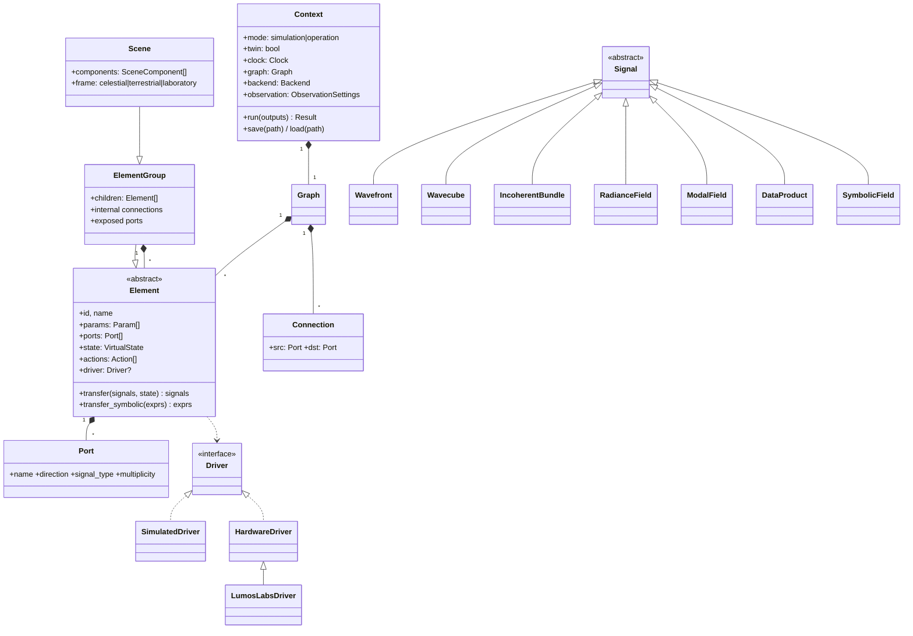
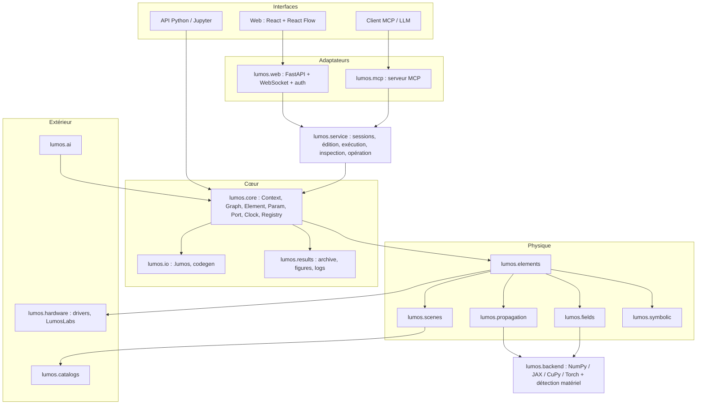

# LUMOS — Cahier des charges

> **LUM(os)²** — *Lumos is a Universal and Modular Optical Simulator & Operating System*
>
> Statut : **v0.2** — 2026-10-16. Document compagnon : [plan_developpement.md](plan_developpement.md).
> Distribution PyPI : **`lumos-maxima`** — import : **`import lumos`**.

---

## Sommaire

1. [Contexte et objectifs](#1-contexte-et-objectifs)
2. [Principes de conception](#2-principes-de-conception)
3. [Cas d'usage](#3-cas-dusage)
4. [Concepts fondamentaux](#4-concepts-fondamentaux)
5. [Exigences fonctionnelles](#5-exigences-fonctionnelles)
6. [Exigences non fonctionnelles](#6-exigences-non-fonctionnelles)
7. [Stratégie de test et de validation](#7-stratégie-de-test-et-de-validation)
8. [Architecture logicielle](#8-architecture-logicielle)
9. [Conventions physiques et numériques](#9-conventions-physiques-et-numériques)
10. [Format de fichier `.lumos`](#10-format-de-fichier-lumos)
11. [Hors périmètre / limites assumées](#11-hors-périmètre--limites-assumées)
12. [Décisions prises et questions restantes](#12-décisions-prises-et-questions-restantes)
13. [Glossaire](#13-glossaire)

Les exigences sont identifiées `REQ-<domaine>-<n>` et hiérarchisées :
**[M]** obligatoire (*must*), **[S]** souhaitable (*should*), **[C]** confort / ultérieur (*could*).

---

## 1. Contexte et objectifs

LUMOS est une bibliothèque Python accompagnée d'une interface web et d'un serveur MCP. Elle :

1. **Simule** de bout en bout la propagation de la lumière : d'une **scène** (astronomique, terrestre ou de laboratoire) jusqu'aux données détectées, à travers un système optique quelconque. Le système peut comprendre de l'optique de volume, de l'optique guidée, de la photonique intégrée, de l'interférométrie, de la coronographie, l'atmosphère et des détecteurs.
2. **Pilote** les équipements optiques réels branchés à l'ordinateur via la même description objet. Un même composant fonctionne en mode **simulation** ou en mode **opération**, et un **jumeau numérique** tourne en parallèle du matériel réel.
3. **Traite** les données, simulées ou réelles, au moyen de pipelines de blocs préconstruits : réduction, estimation des capacités de détection et de caractérisation.
4. **Assiste** l'utilisateur via un **serveur MCP**, qui permet à un LLM de construire, exécuter, analyser et expliquer des simulations, des pipelines et des acquisitions.
5. **Infère** à terme (blocs IA) : calibration du système par comparaison réel/simulé, reconstruction de la scène observée à partir d'un a priori.

### Domaines d'application

| Priorité | Domaine | Exemples |
|----------|---------|----------|
| **Premier** | Astronomie | Étoiles, exoplanètes, disques exo-zodiacaux ; **objets diffus** (nébuleuses, galaxies, disques de débris, surfaces planétaires résolues) ; imagerie, coronographie, interférométrie, spectroscopie |
| Banc optique | Laboratoire | Lasers, lentilles, platines, puces photoniques, caméras ; calibration et acquisition |
| Ultérieur | Observation de la Terre | Satellite imageur (scène = carte de radiance terrestre, orbite, attitude, balayage *pushbroom* ou matriciel, atmosphère) |
| Ultérieur | Photographie / vision | Appareil photo (scène 3D ou image + profondeur, objectif, mise au point, filtre de Bayer) |

Le cœur est conçu pour **ne pas présupposer l'astronomie**. La scène est une description générique de la radiance (§5.3). L'astronomie en est la première spécialisation.

### Objectifs mesurables

| # | Objectif | Indicateur |
|---|----------|------------|
| O1 | Prédire la réponse instrumentale d'un système quelconque | Reproduire des résultats de référence analytiques et publiés (PSF d'Airy, réjection de coronographes idéaux, réponse de nulleurs, MTF d'optiques limitées par la diffraction) aux tolérances fixées par les tests |
| O2 | Propager n'importe quelle grille vers n'importe quelle autre | Écart < 1e-3 (relatif, en énergie) par rapport à l'intégrale de Rayleigh-Sommerfeld directe sur la suite de validation |
| O3 | Exploiter le matériel au mieux | Sélection automatique CPU/GPU ; accélération ≥ ×10 sur GPU pour un Wavecube 2048² × 32 λ par rapport au CPU de référence |
| O4 | Interfaces équivalentes | Python, web et MCP s'appuient sur la même couche de service ; tout contexte construit par l'une s'exporte en `.lumos` et en script Python, et inversement |
| O5 | Résultats traçables | Chaque exécution archivée : contexte, métadonnées, logs, figures `.png` et `.plt` |
| O6 | Fiabilité | Tests écrits avant le code, valeurs attendues issues de sources indépendantes, zéro test modifié sans justification tracée (§7) |

---

## 2. Principes de conception

1. **Graphe explicite.** Les éléments ont des **ports typés** et sont reliés par des connexions explicites dans un graphe orienté. Pas de routage implicite par ordre, pas de couches figées.
2. **Protocoles, pas de cas particuliers.** Le moteur ne connaît aucun élément concret : il manipule des rôles (une source émet, un élément transforme, un détecteur détecte, un bloc traite). Aucun test sur des noms de classe.
3. **Conteneurs de données dédiés.** Les champs sont des tableaux du backend de calcul, sans unité, décrits par une grille explicite. Les unités sont portées par les métadonnées et les paramètres. Les conteneurs ne dérivent pas de `Quantity`.
4. **Vectorisation de première classe.** Longueurs d'onde, polarisation, modes incohérents et positions de champ sont des **axes de tableau**, pas des listes Python.
5. **Les composants sont des éléments.** Lentille, masque ou miroir sont des éléments du graphe, pas des options de la fonction de propagation.
6. **Séparation état / calcul.** L'état d'un équipement (actions, driver) est distinct de sa fonction de transfert. Le transfert est pur : il reçoit l'état en argument. C'est une condition pour la JIT, le parallélisme et la différentiation.
7. **Interface pilotée par schéma.** Chaque élément décrit ses paramètres et ses ports (schéma JSON). Web, MCP, sérialisation et génération de code en dérivent, sans code écrit à la main par composant.
8. **Dépendances minimales.** Les bibliothèques lourdes ou spécialisées sont des *extras* optionnels.
9. **Sécurité par défaut.** Pas de désérialisation arbitraire, TLS toujours vérifié, pilotage matériel interdit par défaut hors usage local.
10. **Modules courts et ciblés.** La physique pure, l'API des éléments et la visualisation vivent dans des modules séparés.
11. **Tests d'abord** (§7).

---

## 3. Cas d'usage

| ID | Acteur | Cas d'usage |
|----|--------|-------------|
| UC1 | Astronome instrumentaliste | Construire un interféromètre à frange noire (réseau de télescopes + puce photonique de recombinaison), injecter une étoile issue des catalogues et sa planète, prédire les sorties et la carte de transmission |
| UC2 | Astronome | Simuler l'image coronographique d'un disque de débris ou d'une nébuleuse (objet diffus) à partir d'un modèle paramétrique ou d'une image FITS |
| UC3 | Expérimentateur de banc | Décrire son banc (laser, lentilles, platines, puce, caméra), le simuler, puis basculer en mode opération avec la même séquence de commandes |
| UC4 | Expérimentateur de banc | Calibrer les phases d'une puce en mode opération en comparant en continu au jumeau numérique |
| UC5 | Étudiant / vulgarisation | Ouvrir l'interface web publique, charger un préréglage et suivre le tutoriel pas à pas |
| UC6 | Développeur | Intégrer LUMOS dans un code plus large (boucle d'optimisation, étude paramétrique sur cluster) |
| UC7 | Scientifique des données | Construire un pipeline de traitement (dark, empilement, estimateur, test statistique, ROC) et évaluer la capacité de détection |
| UC8 | Opticien | Comparer les méthodes de propagation et vérifier l'échantillonnage d'un système |
| UC9 | Tout utilisateur + LLM | Demander à un assistant (via MCP) : « Quel contraste atteint ce coronographe à 3 λ/D ? », « Construis-moi un banc pour mesurer la MTF de cet objectif », « Pourquoi ma simulation est-elle sous-échantillonnée ? » |
| UC10 | Ingénieur système spatial (ultérieur) | Simuler un satellite d'observation de la Terre : scène de radiance terrestre, orbite, attitude, balayage, MTF, SNR, GSD |
| UC11 | Ingénieur vision (ultérieur) | Simuler un appareil photo : scène avec profondeur, objectif, mise au point, capteur à filtre de Bayer |
| UC12 | Chercheur (ultérieur) | Reconstruire la scène (positions et flux des compagnons, carte d'un objet diffus) à partir de données réelles et d'un a priori |

---

## 4. Concepts fondamentaux



- **Element** : tout objet du système (source, composant optique, détecteur, nœud de calcul, bloc IA). Il porte des **paramètres** (`Param`, avec unités), des **ports** typés, un **état virtuel**, une **fonction de transfert** numérique et, en option, symbolique, des **actions** (commandes, éventuellement temporisées) et, en option, un **driver** matériel.
- **ElementGroup** : élément composite (système planétaire, puce et ses sous-composants, objectif multi-lentilles…) qui expose certains ports internes comme ses propres ports. Imbrication libre.
- **Scene** : groupe spécialisé qui décrit ce qui est observé (§5.3).
- **Graph** : graphe orienté acyclique d'éléments reliés par des **connexions** port → port.
- **Signal** : ce qui circule sur une connexion (champs optiques, radiance, données, expressions).
- **Context** : conteneur et coordinateur (graphe, horloge, mode, jumeau, backend, paramètres d'observation, journal, graines).

---

## 5. Exigences fonctionnelles

### 5.1 Éléments, paramètres et modes

| ID | Prio | Exigence |
|----|------|----------|
| REQ-EL-1 | M | Tout équipement ou bloc est une classe dérivée de `Element`. Ses paramètres sont déclarés de façon **déclarative** (`Param(unit=u.m, default=…, bounds=…, doc=…)`), ce qui donne automatiquement la validation d'unité, le stockage interne SI performant, la sérialisation, le schéma JSON et l'invalidation du cache aval à la modification. |
| REQ-EL-2 | M | L'utilisateur manipule des `astropy.units.Quantity` ; l'unité saisie est conservée pour l'affichage. En interne, les valeurs sont stockées en SI sous forme de `float` ou de tableau. |
| REQ-EL-3 | M | Chaque paramètre peut être marqué **libre** (`free=True`), avec un **a priori** optionnel (distribution) et des bornes. C'est le prérequis de la calibration et de l'inférence (§5.15). |
| REQ-EL-4 | M | Deux modes d'opération : **simulation** et **opération**, définis au niveau du `Context`. On peut déclarer une **dérogation** pour un élément donné (ex. élément sans équipement réel, toujours simulé). |
| REQ-EL-5 | M | **Actions.** Méthodes décorées (`@action(duration=…)`) qui modifient l'état de l'équipement. En simulation, aucune commande réelle n'est envoyée : la commande est **journalisée**, l'**état virtuel** est mis à jour et l'horloge du contexte avance de la durée de l'action. En opération, la commande part vers le driver, l'état est relu depuis l'équipement, et la durée réelle est mesurée et enregistrée. |
| REQ-EL-6 | M | La durée d'une action est soit fixe, soit **calculée depuis les propriétés** de l'objet (ex. `distance / vitesse + accélération`, temps de pose + lecture). |
| REQ-EL-7 | M | **Jumeau numérique.** En opération, chaque commande est aussi appliquée au modèle simulé, et les sorties réelles et simulées sont produites côte à côte avec leurs résidus. Le jumeau est activé par défaut en opération et peut être désactivé explicitement. |
| REQ-EL-8 | M | Un élément qui agit sur la lumière fournit une **fonction de transfert numérique** acceptant les signaux optiques (§5.2) : `Wavefront`, `Wavecube`, polarisés ou non, et `IncoherentBundle`. Elle est vectorisée sur tous les axes. |
| REQ-EL-9 | S | Un élément peut fournir une **fonction de transfert symbolique**. À défaut, le moteur bascule sur la voie numérique (§5.6). |
| REQ-EL-10 | M | Les fonctions de transfert numériques sont **pures** (principe 6). |
| REQ-EL-11 | M | Introspection : `describe()`, `schema()` (JSON Schema), représentation riche dans Jupyter. |
| REQ-EL-12 | M | Import/export **individuel** d'un élément ou d'un groupe en `.lumos` (§10). |

### 5.2 Signaux et représentations du champ

| ID | Prio | Exigence |
|----|------|----------|
| REQ-SIG-1 | M | `Grid` : échantillonnage 2D **rectangulaire** (`nx ≠ ny` autorisé), pas `dx, dy`, centre décalable, nature du plan (spatial en m, angulaire en rad), convention de centrage unique (§9). |
| REQ-SIG-2 | M | `Wavefront` : champ complexe discret sur une `Grid` à une longueur d'onde. Il expose `intensity`, `amplitude`, `phase`, `power`. Stockage : tableau du backend courant, sans unité ; la normalisation (W ou photons/s) est en métadonnée. |
| REQ-SIG-3 | M | `Wavefront` polarisé : composantes de Jones `(Ex, Ey)`, forme `(2, ny, nx)`. Les éléments polarisants agissent par matrices de Jones (uniformes ou variables dans l'espace). |
| REQ-SIG-4 | M | `Wavecube` : pile de fronts d'onde sur un axe spectral, forme `(nλ, [2,] ny, nx)`, avec poids spectraux. La grille est commune à toutes les longueurs d'onde, ce que la propagation grille-à-grille permet de garantir. |
| REQ-SIG-5 | M | `IncoherentBundle` : ensemble de modes **mutuellement incohérents** (sources ponctuelles, échantillons d'une scène étendue, modes de cohérence partielle, polarisation partielle). La propagation est vectorisée sur l'axe des modes et la somme se fait **en intensité** à la détection. |
| REQ-SIG-6 | M | `RadianceField` : description incohérente d'une scène, c'est-à-dire la radiance spectrale `L(x, y, λ [, Stokes] [, t])` sur une grille (angulaire ou spatiale), avec unités radiométriques (§5.3). |
| REQ-SIG-7 | M | `ModalField` : amplitudes complexes par guide d'onde ou par mode, vectorisées sur λ et sur les modes incohérents. Les composants photoniques agissent par **matrices de diffusion** (S-matrices), éventuellement dépendantes de λ. |
| REQ-SIG-8 | M | Conversions : couplage `Wavefront → ModalField` par intégrales de recouvrement avec les modes (fibres, guides) et `ModalField → Wavefront` (sortie de fibre). |
| REQ-SIG-9 | M | `DataProduct` : données détectées (image, cube, série temporelle, scalaires) avec unités (ADU, e⁻, photons), axes physiques, masque, incertitudes et métadonnées d'acquisition. Exportable en FITS, NPZ ou HDF5. |
| REQ-SIG-10 | M | `SymbolicField` : expression symbolique du champ (§5.6). |
| REQ-SIG-11 | M | Tous les signaux sont **typés** sur les ports. La connexion de deux ports incompatibles est refusée, ou proposée avec un convertisseur explicite. |

### 5.3 Scènes

| ID | Prio | Exigence |
|----|------|----------|
| REQ-SCN-1 | M | Une `Scene` est un `ElementGroup` composé de `SceneComponent` et placé dans un **repère** : céleste (ICRS, coordonnées angulaires, objet à l'infini), terrestre (géodésique : latitude, longitude, altitude) ou laboratoire (distance finie, coordonnées en m). |
| REQ-SCN-2 | M | Composants **ponctuels** : spectre arbitraire, position et mouvement éventuel. Les spécialisations astronomiques (`Star`, `Planet`, systèmes planétaires avec géométrie orbitale) sont fournies en v1. |
| REQ-SCN-3 | M | Composants **diffus paramétriques** : disque uniforme, gaussienne, profil de Sérsic, anneau ou disque incliné (disques de débris, exo-zodi), lumière zodiacale locale, fond uniforme ; chacun avec son spectre ou une dépendance spectrale spatialement variable. |
| REQ-SCN-4 | M | Composants **cartographiés** : import de cartes de radiance (FITS avec WCS, cubes hyperspectraux, PNG/TIFF avec calibration, GeoTIFF à terme), avec conversion d'unités radiométriques et rééchantillonnage conservatif du flux. |
| REQ-SCN-5 | M | **Radiométrie** rigoureuse : radiance spectrale, éclairement, flux dans la pupille, étendue, conversion énergie ↔ photons, systèmes de magnitudes et bandes photométriques. |
| REQ-SCN-6 | M | **Imagerie de scènes étendues incohérentes**, avec une stratégie choisie automatiquement (et forçable) : (a) **isoplanatique** : convolution de la scène par la PSF(λ) via FFT ; (b) **anisoplanatique** : PSF variable dans le champ, par grille de PSF interpolée ou convolution spatialement variable ; (c) **décomposition explicite** de la scène en `IncoherentBundle`, obligatoire pour les systèmes non invariants par translation (coronographe, interféromètre, injection en fibre). Le choix et la justification sont journalisés. |
| REQ-SCN-7 | M | Scènes **dépendantes du temps** : mouvements orbitaux, rotation de champ, variabilité, lecture de `ctx.time`. |
| REQ-SCN-8 | S | Composants **procéduraux** (textures, champs aléatoires) pour les tests et l'imagerie générique. |
| REQ-SCN-9 | C | **Observation de la Terre** : scène de radiance terrestre ; plateforme en orbite (TLE/SGP4 ou éléments képlériens) avec attitude et pointage ; modes de détection matriciel, *pushbroom* et TDI ; modèle atmosphérique simple (transmission et radiance de trajet), avec des outils de transfert radiatif externes branchables en plugin ; métriques MTF, GSD et SNR. |
| REQ-SCN-10 | C | **Photographie** : scène image + carte de profondeur (ou maillage 3D simple) à distance finie, objectif épais (ABCD) avec ouverture et mise au point, défocalisation selon la profondeur, capteur à filtre de Bayer, dématriçage. |

### 5.4 Propagation numérique (plan discret → plan discret)

| ID | Prio | Exigence |
|----|------|----------|
| REQ-PROP-1 | M | Propagation de **n'importe quelle grille** (résolution, taille, centre) vers **n'importe quelle autre**, pour toute distance (z = 0, z < 0 en rétro-propagation, z → ∞) et toute longueur d'onde. |
| REQ-PROP-2 | M | Méthodes : Fraunhofer (FFT) ; **MFT** (*Matrix Fourier Transform*, Soummer et al. 2007) ; Fresnel en fonction de transfert et en réponse impulsionnelle ; Fresnel en deux étapes ; **ASM** à bande limitée (Matsushima & Shimobaba 2009) ; ASM mis à l'échelle ou décalé (MFT ou *chirp-z*) ; Rayleigh-Sommerfeld par convolution FFT ; Rayleigh-Sommerfeld **direct** (référence) ; transformée pupille ↔ plan focal. |
| REQ-PROP-3 | M | **Planificateur** (`plan_propagation(grid_in, grid_out, z, λ)`) : il calcule le nombre de Fresnel, les critères d'échantillonnage (repliement du noyau, critère de Voelz & Roggemann), le rembourrage et le coût estimé (mémoire, FLOP) sur le matériel détecté. Il choisit la méthode **la plus efficace qui respecte la tolérance** demandée. Le choix et les avertissements sont journalisés ; l'utilisateur peut imposer une méthode. |
| REQ-PROP-4 | M | Conservation de l'énergie (Parseval) vérifiée pour chaque méthode, avec une normalisation physique cohérente entre méthodes. |
| REQ-PROP-5 | M | Vectorisation native sur λ, la polarisation et les modes incohérents ; cache des noyaux (matrices MFT, fonctions de transfert). |
| REQ-PROP-6 | M | Propagation **différentiable** sous le backend JAX. |
| REQ-PROP-7 | C | Méthodes avancées : BPM, diffraction vectorielle de Richards-Wolf, tracé de rayons (ABCD, puis rayons réels). |
| REQ-PROP-8 | S | Bibliothèques établies (POPPY, HCIPy, PROPER, LightPipes) utilisées comme **références de validation indépendantes** (extra `[validation]`), jamais comme dépendances d'exécution. |

### 5.5 Contexte, graphe et exécution

| ID | Prio | Exigence |
|----|------|----------|
| REQ-CTX-1 | M | Le `Context` contient et coordonne tous les éléments. |
| REQ-CTX-2 | M | Graphe orienté **acyclique** au niveau des signaux. Les boucles physiques (OA, asservissement, calibration itérative) sont des **itérations temporelles** pilotées par le contexte. |
| REQ-CTX-3 | M | API fluide : `ctx.add(elem)`, `ctx.connect(a.out, b.in_)`, `a >> b` (raccourci quand les ports sont uniques), accès par nom (`ctx["telescope.pupil"]`). |
| REQ-CTX-4 | M | Exécution **pull** : `ctx.run(outputs=[...])` ne calcule que le sous-graphe nécessaire, en ordre topologique, avec cache par port et invalidation en aval à chaque changement de paramètre ou d'état. |
| REQ-CTX-5 | M | **Horloge** : date de début (`astropy.time.Time`) et temps écoulé, avancée par les actions ou explicitement (`ctx.wait(10*u.s)`). `with ctx.parallel():` avance l'horloge du maximum des durées. Les éléments dépendants du temps lisent `ctx.time`. |
| REQ-CTX-6 | M | Paramètres d'observation globaux : échantillonnage spectral, site ou plateforme, pointage, graines aléatoires. |
| REQ-CTX-7 | M | `ElementGroup` : ports exposés, paramètres agrégés, sérialisation ; réduction à une matrice de transfert globale quand les enfants sont linéaires. |
| REQ-CTX-8 | M | Import/export du contexte entier en `.lumos` ; génération d'un **script Python équivalent**. |
| REQ-CTX-9 | M | Journal structuré (`logging` standard, aucun `print`) : commandes, états, choix numériques, avertissements physiques, durées, et origine de chaque action (Python, web ou MCP). |
| REQ-CTX-10 | S | Balayages paramétriques et Monte-Carlo (`ctx.sweep`), parallélisés (`vmap`, processus). |
| REQ-CTX-11 | S | Vue « schéma » : diagramme du graphe en SVG ou PNG. |

### 5.6 Symbolique

| ID | Prio | Exigence |
|----|------|----------|
| REQ-SYM-1 | M | `SymbolicField` : expression SymPy du champ en fonction de variables canoniques (`x, y` ou `θx, θy`, `λ`, `t`) et de paramètres liés aux `Param`, avec domaine et plan. |
| REQ-SYM-2 | M | **Symbols → grid** : évaluation sur une `Grid` (→ `Wavefront`), ou sur une `Grid` × axe spectral (→ `Wavecube`) si l'expression dépend de λ. Compilation `lambdify` vers le backend, mise en cache, **anti-crénelage** des discontinuités par sur-échantillonnage et intégration par pixel. |
| REQ-SYM-3 | M | **Grid → symbols**, plusieurs méthodes : projection modale (Zernike, Hermite-Gauss, Laguerre-Gauss, modes LP, Fourier) contrôlée par l'erreur résiduelle ; ajustement de modèles paramétriques (gaussien, paramètre q complexe, Airy) ; régression parcimonieuse ; régression symbolique (PySR) en option. Chaque reconstruction renvoie l'expression et une métrique d'erreur. |
| REQ-SYM-4 | M | **Propagation symbolique** par chaînage des transferts symboliques, avec exploitation des formes closes (faisceaux gaussiens, HG et LG via ABCD ; transformées tabulées circ → Airy, rect → sinc). |
| REQ-SYM-5 | M | **Repli explicite** quand il n'y a pas de forme close ou qu'un délai est dépassé : échantillonnage, propagation numérique, puis reconstruction éventuelle ; le journal l'indique. |
| REQ-SYM-6 | S | Rendu LaTeX des expressions (Jupyter, doc, web, MCP). |

### 5.7 Calcul haute performance et matériel

| ID | Prio | Exigence |
|----|------|----------|
| REQ-HPC-1 | M | **Abstraction de backend** (Array API) : NumPy (référence CPU), **JAX** (backend différentiable de référence : JIT, `vmap`, autodiff, GPU/TPU), CuPy et PyTorch en option. |
| REQ-HPC-2 | M | **Détection du matériel** (`lumos.hardware_report()`) : OS, CPU, RAM, GPU et VRAM, CUDA/ROCm/Metal, bibliothèques. **Sélection automatique** du backend et du nombre de *threads* FFT, forçable par l'utilisateur. |
| REQ-HPC-3 | M | Compilation adaptée à chaque fonction coûteuse : JAX `jit`/`vmap` pour les noyaux vectorisables et différentiables ; `numba` pour les boucles CPU non vectorisables ; C++ (nanobind) seulement si un profilage le justifie (ADR). |
| REQ-HPC-4 | M | Gestion mémoire : estimation préalable, découpage automatique sur λ, les modes et le champ. |
| REQ-HPC-5 | M | Précision configurable (`complex64` / `complex128`). |
| REQ-HPC-6 | S | *Benchmarks* reproductibles suivis dans le temps. |
| REQ-HPC-7 | C | Exécution distribuée (multi-GPU, Dask ou Ray). |

### 5.8 Pilotage d'équipements (mode opération)

| ID | Prio | Exigence |
|----|------|----------|
| REQ-HW-1 | M | Interface `Driver` : `connect`, `disconnect`, `send`, `query`, `status`, `stop`. `SimulatedDriver` journalise les commandes et renvoie l'état virtuel. |
| REQ-HW-2 | M | **Découverte** des équipements connectés (USB, série, VISA, TCP, SDK) et association à des éléments. |
| REQ-HW-3 | M | **Équipements fictifs « LumosLabs »** : gamme d'équipements virtuels de référence (§5.8.1), chacun avec un **émulateur** qui implémente un protocole documenté sur un transport réel (série virtuelle ou TCP local). Les drivers LumosLabs traversent donc le même chemin de code qu'un équipement physique : transport, erreurs, latences, délais. |
| REQ-HW-4 | M | **Sécurité** : bornes logicielles sur chaque paramètre actionnable, **arrêt d'urgence** global (`ctx.stop_all()`), confirmation des actions dangereuses, mode *dry-run*, délais d'attente et reprise sur erreur, retour à un état sûr après une interruption (Ctrl+C). |
| REQ-HW-5 | M | Les données réelles sont produites sous forme de `DataProduct`, identiques à celles de la simulation : un pipeline fonctionne indifféremment sur des données réelles ou simulées. |
| REQ-HW-6 | M | Jumeau numérique (REQ-EL-7) disponible pour tous les drivers. |
| REQ-HW-7 | S | Enregistrement et rejeu de **séquences** d'actions, en simulation puis en opération. |
| REQ-HW-8 | M | Plugins de drivers via les *entry points*. Les drivers constructeurs (Thorlabs en premier, puis d'autres) sont ajoutés au fil des besoins, sur le modèle validé avec LumosLabs. |

#### 5.8.1 Gamme LumosLabs (v1)

| Équipement | Rôle | Comportement émulé |
|------------|------|---------------------|
| `LL-LS100` platine linéaire | translation | vitesse, accélération, butées, *homing*, erreur de position, dérive |
| `LL-RS360` platine de rotation | rotation | idem, angulaire |
| `LL-PZ3` contrôleur piézo 3 axes | alignement fin | hystérésis, plage, bruit |
| `LL-SH1` obturateur | obturation | temps d'ouverture et de fermeture |
| `LL-FW6` roue à filtres | sélection spectrale | 6 positions, temps de changement |
| `LL-LD` source laser ou superluminescente | source | puissance, λ, stabilité, temps de chauffe |
| `LL-PM` puissance-mètre | mesure | gamme, bruit, temps d'intégration |
| `LL-CAM` caméra scientifique | détection | pose, gain, bruits, ROI, déclenchement ; les images proviennent du jumeau simulé avec bruit |
| `LL-PCU` contrôleur de phases de puce | photonique | N canaux de chauffage (tension ou courant → phase), diaphonie thermique, temps de stabilisation |

Les émulateurs supportent l'**injection de fautes** (déconnexion, délai, valeur hors bornes, blocage) pour tester la robustesse.

### 5.9 Bibliothèque d'éléments (v1)

| Famille | Éléments |
|---------|----------|
| Scènes | voir §5.3 ; sources de laboratoire : laser gaussien, LED ou lampe incohérente, fibre éclairée, mire (USAF, Siemens) |
| Environnement | Atmosphère (couches von Kármán, écoulement figé dépendant du temps, chromatique), vide |
| Collecte / échantillonnage | Pupille paramétrique (disques, polygones, obstruction, araignées, primaire segmenté ; préréglages JWST, VLT, ELT…), télescope, réseau de télescopes (préréglages VLTI, LIFE…), diaphragmes, masques |
| Optique de volume | Espace libre, lentille ou miroir mince (et épaisse via ABCD), séparatrice, lames de phase, polariseurs, lames d'onde, filtre spectral, miroir déformable (Zernike, actionneurs), coronographes (4QPM, vortex, Lyot), ligne à retard |
| Optique guidée | Fibre monomode et multimode (modes LP), injection et extraction |
| Photonique intégrée | Guide, déphaseur thermo-optique, Y-splitter, coupleur directionnel, MMI (solveur de modes), croisement ; puce = `ElementGroup` de S-matrices ; préréglages de recombinateurs (Bracewell, nulleur à noyaux d'après Martinache & Ireland 2018) |
| Détection | Caméra (QE(λ), bruits de photons, de lecture et d'obscurité, gain, saturation, binning, pose temporisée), photodiode, puissance-mètre, spectrographe simple |
| Calcul / données | voir §5.11 |

### 5.10 Catalogues astronomiques

| ID | Prio | Exigence |
|----|------|----------|
| REQ-CAT-1 | M | `lumos.catalogs.resolve("<nom>")` identifie le type d'objet et renvoie un **objet typé** (`StarRecord`, `ExoplanetRecord`, `SolarSystemRecord`, `ExtendedObjectRecord`…), avec unités, incertitudes et **provenance par champ**. |
| REQ-CAT-2 | M | Fournisseurs : SIMBAD, VizieR (photométrie et spectres), Gaia DR3, CALSPEC (STScI), ESO Phase 3, IRSA, MAST, NASA Exoplanet Archive, exoplanet.eu, JPL Horizons, SVO Filter Profile Service, spectre solaire de référence (ASTM E490), bibliothèques de spectres modèles (Pickles…). |
| REQ-CAT-3 | M | **Objets diffus** : récupération d'images ou de cubes (SkyView, HiPS/hips2fits, archives MAST et ESO) convertibles en composants cartographiés de scène (REQ-SCN-4). |
| REQ-CAT-4 | M | Fusion de SED multi-sources avec règles de priorité documentées ; complétion physique optionnelle signalée comme estimée. |
| REQ-CAT-5 | M | Cache utilisateur (`platformdirs`) à durée de vie configurable, mode **hors-ligne**, **TLS toujours vérifié**, timeouts fixés par requête. |
| REQ-CAT-6 | M | Constructeurs directs : `Star.from_catalog("Vega")`, `Planet.from_catalog("HD 209458 b")`, `Scene.from_catalog("TRAPPIST-1")`, `MappedComponent.from_survey("M42", survey=…)`. |
| REQ-CAT-7 | S | Fournisseurs extensibles par plugins. |

### 5.11 Pipelines de traitement de données

| ID | Prio | Exigence |
|----|------|----------|
| REQ-PIPE-1 | M | Les blocs de traitement sont des `Element` à ports `DataProduct`, branchés dans le même graphe que l'optique. |
| REQ-PIPE-2 | M | Réduction : dark, champ plat, empilement, recadrage et rééchantillonnage, photométrie d'ouverture, profil radial, contraste, SNR. |
| REQ-PIPE-3 | M | Interférométrie : profondeur de nulling, observables à noyaux, cartes de transmission. |
| REQ-PIPE-4 | M | **Capacités de détection et de caractérisation** : statistiques de test (énergie, Neyman-Pearson…), courbes ROC, courbes de contraste limite, capacité de détection en fonction de la séparation et du contraste. |
| REQ-PIPE-5 | M | Calibration classique : ajustement de phases (gradient, essais-erreurs, algorithmes génétiques), mesure de MTF (lame inclinée, ISO 12233), mesure de PSF. |
| REQ-PIPE-6 | S | Bloc « script » : fonction utilisateur encapsulée avec ports déclarés. |

### 5.12 Couche de service et serveur MCP

| ID | Prio | Exigence |
|----|------|----------|
| REQ-SVC-1 | M | **Couche de service** (`lumos.service`) unique, qui expose les opérations de haut niveau (gestion de sessions et de contextes, édition du graphe, exécution asynchrone, inspection, catalogues, archives, opération matérielle). Le backend web **et** le serveur MCP sont deux adaptateurs minces de cette couche (parité garantie par construction). |
| REQ-MCP-1 | M | **Serveur MCP** (`lumos.mcp`, SDK MCP Python officiel), utilisable en **stdio** (usage local : `lumos mcp`) et en **HTTP *streamable*** (adossé à l'instance web, avec la même authentification). |
| REQ-MCP-2 | M | **Outils** (*tools*) couvrant tous les cas d'usage : découverte (`list_element_types`, `get_element_schema`, `search_docs`) ; construction (`create_context`, `add_element`, `connect`, `set_param`, `create_group`, `load_preset`, `import_lumos`, `export_lumos`) ; vérification (`validate_context`, `explain_sampling`, `plan_propagation`) ; exécution (`run`, avec progression, `get_result`, `inspect_port`, qui renvoie des figures en image et des résumés chiffrés) ; catalogues (`resolve_object`) ; traitement (`build_pipeline`, `evaluate_detection`) ; résultats (`list_archives`, `read_archive_metadata`) ; code (`export_python`) ; opération (`list_devices`, `device_status`, `execute_action`, `stop_all`). |
| REQ-MCP-3 | M | **Ressources** (*resources*) : pages de documentation, schémas d'éléments, préréglages, contexte courant, journaux, métadonnées d'archives. **Prompts** guidés par cas d'usage : concevoir un instrument, estimer une capacité de détection, calibrer un banc, diagnostiquer une simulation. |
| REQ-MCP-4 | M | **Sécurité** : les outils d'opération sont **désactivés par défaut**. Une fois activés par la configuration, chaque action matérielle demande une confirmation humaine (*elicitation* MCP), et les bornes et l'arrêt d'urgence sont appliqués côté serveur quelle que soit la requête du LLM. Les actions d'origine MCP sont tracées comme telles dans le journal. Les quotas de calcul s'appliquent. |
| REQ-MCP-5 | M | Réponses **adaptées à un LLM** : résumés compacts, unités toujours explicites, erreurs exploitables (cause, correction suggérée), identifiants stables, pagination des listes longues. |
| REQ-MCP-6 | M | Documentation « Using LUMOS with an AI assistant » : configuration de Claude Code, Claude Desktop et d'autres clients MCP, exemples de conversations. |
| REQ-MCP-7 | S | Suite d'**évaluation** de scénarios MCP (tâches types → résultat attendu vérifiable) exécutée périodiquement. |

### 5.13 Interface web (programmation visuelle)

| ID | Prio | Exigence |
|----|------|----------|
| REQ-WEB-1 | M | Éditeur de graphe : ajouter, supprimer et déplacer des blocs, connecter les ports, avec vérification de type et couleurs par type de signal. |
| REQ-WEB-2 | M | **Palette et formulaires générés** depuis le registre d'éléments ; aucun code par composant. |
| REQ-WEB-3 | M | Saisie des paramètres avec unités (sélecteur, conversion), bornes, documentation contextuelle. |
| REQ-WEB-4 | M | Groupes : création par sélection, repli et dépli, sauvegarde comme bloc réutilisable. |
| REQ-WEB-5 | M | Exécution avec progression et logs en direct (WebSocket), **inspection** de la sortie de n'importe quel port, téléchargement des résultats (`.png`, `.plt`, données, archive). |
| REQ-WEB-6 | M | Import/export `.lumos` et génération du script Python équivalent. |
| REQ-WEB-7 | M | **Préréglages** (les mêmes `.lumos` que les notebooks) et **tutoriel** pas à pas superposé à l'interface. |
| REQ-WEB-8 | M | Interface **bilingue anglais / français**, langue sélectionnable. |
| REQ-WEB-9 | M | **Deux modes de déploiement** : (a) **local** : liaison à `localhost`, opération disponible avec confirmation ; (b) **instance publique** : opération **interdite par défaut**. L'administrateur peut l'autoriser par configuration, et l'accès est alors conditionné à une **authentification par mot de passe** (haché en Argon2id) **ou par clé SSH** (clé publique enregistrée ; preuve par signature d'un défi, via `ssh-keygen -Y sign` ou la commande `lumos login`). Le TLS est alors obligatoire. S'y ajoutent des rôles (lecteur, simulateur, opérateur), des sessions expirantes, une limitation de débit et un journal d'audit. |
| REQ-WEB-10 | M | Quotas de calcul sur l'instance publique (taille de grille, temps, mémoire, concurrence). |
| REQ-WEB-11 | S | Recherche d'objets astronomiques intégrée (catalogues). |
| REQ-WEB-12 | S | Panneau « Assistant » optionnel connecté au serveur MCP. |
| REQ-WEB-13 | M | Déploiement Docker (images *backend* + *frontend*, ou image unique). |

### 5.14 Résultats, figures et archivage

| ID | Prio | Exigence |
|----|------|----------|
| REQ-RES-1 | M | Chaque `ctx.run(...)` peut produire une **archive** via `vfst.archive` (VFSciTools), créée **à côté du script ou du notebook exécuté** (racine configurable). |
| REQ-RES-2 | M | Contenu de l'archive : `context.lumos`, `metadata.yml` (date et heure UTC, OS, version de Python, versions de LUMOS et des dépendances clés, git commit et branche, matériel détecté, backend et précision, graines, durées, mode, jumeau, horloge simulée, origine Python/web/MCP), `lumos.log`, `figures/`, `data/`. |
| REQ-RES-3 | M | Figures **scientifiquement exploitables** : grandeurs et unités sur les axes, barres de couleur étiquetées, cartes de couleurs perceptuelles (cyclique pour la phase), style homogène, tailles adaptées aux publications. |
| REQ-RES-4 | M | Export de chaque figure en `.png` et en `.plt` (`pltedit.save`). |
| REQ-RES-5 | M | Sauvegarde des données sous-jacentes aux figures. |
| REQ-RES-6 | S | `lumos.load_archive(path)` restitue le contexte, les résultats et les métadonnées. |

### 5.15 Blocs IA (à terme)

| ID | Prio | Exigence |
|----|------|----------|
| REQ-AI-1 | C | Blocs appris (débruitage, détection, classification), entraînés sur des jeux de données **générés par LUMOS** à partir des paramètres libres et de leurs a priori. |
| REQ-AI-2 | C | **Calibration** : ajustement des paramètres libres du modèle pour reproduire les données réelles (jumeau numérique), par gradient (JAX) ou sans gradient. |
| REQ-AI-3 | C | **Reconstruction de scène** : inférence bayésienne (NumPyro, BlackJAX) ou inférence par simulation (`sbi`) à partir d'une scène a priori paramétrée, ponctuelle ou diffuse. |
| REQ-AI-4 | C | Modèles de substitution (*surrogates*) appris pour les sous-graphes coûteux. |

> REQ-EL-3, REQ-EL-10 et REQ-PROP-6 sont **obligatoires dès la v1** pour que §5.15 n'impose pas de refonte.

### 5.16 Exemples, tutoriels, documentation

| ID | Prio | Exigence |
|----|------|----------|
| REQ-DOC-1 | M | Documentation Sphinx sur **ReadTheDocs**, thème **Breeze** (`sphinx-breeze-theme`), MyST, Mermaid, autodoc et autosummary. |
| REQ-DOC-2 | M | Documentation **bilingue anglais / français** : anglais comme langue source, français par traduction gettext (`sphinx-intl`), publié comme projet de traduction RTD. |
| REQ-DOC-3 | M | **Docstrings, notebooks d'exemple, noms d'API, identifiants et messages : anglais uniquement.** |
| REQ-DOC-4 | M | Sections : *Getting started*, *User guide*, *Learn* (physique), *Examples*, *API*, *Hardware* (dont LumosLabs), *Web*, *AI assistant (MCP)*, *Contributing*, *ADR*. |
| REQ-DOC-5 | M | Notebooks numérotés dans `examples/`, **exécutés en CI** et rendus dans la doc ; chaque préréglage web correspond à un notebook et à un `.lumos` partagé. |
| REQ-DOC-6 | M | Les docstrings expliquent la **physique** (formules, hypothèses, références bibliographiques). |

---

## 6. Exigences non fonctionnelles

| ID | Prio | Exigence |
|----|------|----------|
| NF-1 | M | **Public large.** Les versions de Python supportées suivent la politique **SPEC 0** de l'écosystème scientifique : toutes les versions encore supportées à la fois par NumPy, SciPy, Astropy et JAX, testées en CI. En pratique, la borne basse est imposée par ces dépendances (vraisemblablement 3.12 en 2026, à confirmer en P0). Windows, Linux et macOS. |
| NF-2 | M | Dépendances de base minimales : `numpy`, `scipy`, `astropy`, `sympy`, `matplotlib`, `pyyaml`, `platformdirs`, `array-api-compat`, `vfscitools`. Extras : `[jax]`, `[gpu]`, `[torch]`, `[catalogs]`, `[hardware]`, `[web]`, `[mcp]`, `[ai]`, `[validation]`, `[docs]`, `[dev]`, `[all]`. |
| NF-3 | M | Couverture ≥ 85 % sur `core`, `fields`, `propagation`, `service` ; voir §7 pour la stratégie. |
| NF-4 | M | CI GitHub Actions : lint (ruff), typage (pyright ou mypy, strict sur le cœur), tests sur la matrice OS × Python, notebooks, doc EN et FR, contrôle de l'intégrité des tests (§7.3) ; GPU sur exécuteur dédié ou en déclenchement manuel. |
| NF-5 | M | Versionnage sémantique, `CHANGELOG.md`, publication PyPI de `lumos-maxima` par *trusted publishing* sur Release GitHub. |
| NF-6 | M | Reproductibilité : graines explicites, version du format `.lumos`, métadonnées d'archive complètes. |
| NF-7 | M | Sécurité : pas de `pickle` ni d'import arbitraire au chargement d'un `.lumos` (registre en liste blanche) ; TLS vérifié ; authentification et audit (REQ-WEB-9) ; outils MCP d'opération désactivés par défaut ; aucun secret dans les fichiers de contexte. |
| NF-8 | M | Licence MIT. |
| NF-9 | S | Temps d'import de `lumos` < 1 s (imports paresseux). |
| NF-10 | M | Conduite de projet : `CLAUDE.md` (conventions pour les agents), **ADR** (`docs/adr/NNNN-titre.md`) pour chaque décision structurante, messages de commit au format *Conventional Commits* qui référencent l'étape du plan (`feat(P4.3): …`). |

---

## 7. Stratégie de test et de validation

### 7.1 Règle fondamentale : les tests précèdent le code

1. Pour chaque étape du plan, les **tests sont écrits avant l'implémentation**, à partir de la spécification de l'étape. Ils échouent au départ (« rouge »).
2. Les tests sont **commités séparément**, avant le code : `test(Px.y): …`.
3. L'implémentation est écrite **sans modifier les tests** jusqu'à ce qu'ils passent : `feat(Px.y): …`.
4. Un test ne peut être modifié qu'en cas de **changement d'objectif** (consigné dans un ADR ou dans le cahier des charges) ou d'**erreur ou limite avérée du test** (valeur de référence fausse, tolérance physiquement injustifiée, hypothèse incorrecte). La modification fait alors l'objet d'un **commit dédié** `test(Px.y)!: …` dont le message explique la raison et cite la source qui fait foi. Elle n'est **jamais** mélangée à du code d'implémentation.
5. Assouplir une tolérance pour faire passer une implémentation est interdit, sauf justification physique documentée.

### 7.2 Valeurs attendues indépendantes (pas d'auto-validation)

- Les valeurs de référence proviennent de sources **indépendantes de l'implémentation** : solutions analytiques, résultats publiés (avec référence bibliographique dans le test), bibliothèques établies et indépendantes (POPPY, HCIPy, PROPER, LightPipes, astropy), ou données de mesure.
- Il est **interdit** de générer une valeur attendue en exécutant le code testé.
- Les tests de non-régression (« *snapshot* ») ne sont permis qu'**après** une validation indépendante, sont marqués comme tels et ne remplacent pas les tests physiques.
- Les tests de propriétés (*property-based*, Hypothesis) sont encouragés pour les invariants : conservation de l'énergie, unitarité des S-matrices, réciprocité, linéarité, symétries, aller-retour de sérialisation et de changement de backend.

### 7.3 Contrôles automatiques

- Un job CI signale tout commit qui modifie à la fois `tests/` et `src/`, ainsi que toute modification de test sans le préfixe `test(…)!`.
- Les tests sont paramétrés par backend (NumPy, JAX, et CuPy si disponible).
- Les tests réseau (catalogues) et matériel (drivers réels) sont marqués et exclus par défaut ; les drivers LumosLabs sont testés en CI via leurs émulateurs.

### 7.4 Familles de tests

| Famille | Exemples |
|---------|----------|
| Unitaires | validation d'unités, `Param`, `Grid`, sérialisation, registre |
| Physiques | premier zéro d'Airy à 1,22 λ/D, faisceau gaussien w(z) et R(z), Parseval, réciprocité, réjection d'un coronographe idéal, unitarité d'un coupleur, radiométrie (flux d'un corps noir intégré) |
| Croisés | cohérence des méthodes de propagation entre elles et avec RS direct ; comparaison avec les bibliothèques indépendantes |
| Intégration | contextes complets (UC1, UC2, UC3 en simulation, UC7) |
| Service / MCP / web | outils MCP via un client MCP de test ; API HTTP ; parcours frontend de bout en bout (Playwright) |
| Robustesse matériel | émulateurs LumosLabs avec injection de fautes |
| Performance | *benchmarks* suivis (pas de critère bloquant hors régressions majeures) |

---

## 8. Architecture logicielle

### 8.1 Vue en couches



### 8.2 Arborescence cible

```
LUMOS/
├── src/lumos/
│   ├── __init__.py  config.py  units.py
│   ├── backend/        # array API, FFT, JIT, détection matériel
│   ├── core/           # Element, Param, Port, Signal, Graph, Context, Clock, Action, Registry
│   ├── fields/         # Grid, Wavefront, Wavecube, Jones, IncoherentBundle, RadianceField, ModalField, DataProduct
│   ├── scenes/         # Scene, composants ponctuels, diffus, cartographiés ; repères ; radiométrie ; stratégies d'imagerie
│   ├── propagation/    # méthodes + planificateur
│   ├── symbolic/
│   ├── elements/       # environment/ apertures/ optics/ guided/ photonics/ detectors/ processing/
│   ├── physics/        # modules physiques purs (modes, SED, orbites, bruits…)
│   ├── hardware/       # Driver, SimulatedDriver, transports, discovery, lumoslabs/ (drivers + émulateurs), vendors/
│   ├── catalogs/
│   ├── io/             # .lumos (schéma, migrations), codegen
│   ├── results/        # archive (vfst), figures (pltedit), style
│   ├── plotting/
│   ├── service/        # couche de service commune web/MCP
│   ├── mcp/            # serveur MCP
│   ├── web/            # backend FastAPI, auth
│   ├── ai/             # (ultérieur)
│   └── cli.py          # `lumos` : mcp, web, login, report, emulators
├── web/                # frontend (React, Vite, @xyflow/react, i18n EN/FR)
├── examples/           # notebooks + presets/*.lumos
├── tests/  unit/ physics/ cross/ integration/ service/ mcp/ web/ hardware/ benchmarks/
├── docs/   (Sphinx Breeze, EN + locales/fr) + adr/ + specs/
├── .github/workflows/
├── pyproject.toml  CHANGELOG.md  CLAUDE.md  LICENSE  README.md
```

### 8.3 Choix technologiques

| Besoin | Choix | Justification |
|--------|-------|---------------|
| Unités | `astropy.units` à la frontière, SI en interne | Exigé |
| Tableaux | `array-api-compat` | Un seul code, plusieurs backends |
| Backend différentiable | **JAX** (décidé) | JIT, `vmap`, autodiff, GPU ; écosystème d'inférence (NumPyro, BlackJAX, optax) |
| Boucles CPU | `numba` | Boucles non vectorisables hors JAX |
| Extension native | C++ / nanobind si mesuré | Mojo écarté pour l'instant (écosystème Python encore immature), à réévaluer |
| Symbolique | `sympy`, `pysr` en option | Standard, compilable |
| Graphe | implémentation interne légère | Besoin simple |
| Sérialisation | JSON + JSON Schema versionné + *sidecar* `.npz` | `.lumos`, sûr |
| Service web | FastAPI, Pydantic, WebSocket ; `argon2-cffi` ; vérification des signatures SSH (`ssh-keygen -Y verify` ou `cryptography`) | Robuste, typé |
| MCP | SDK MCP Python officiel | Standard |
| Frontend | React + Vite + `@xyflow/react` + Tailwind + i18next ; tutoriel `driver.js` | Éditeur de graphe mature |
| Matériel | transports `pyserial`, `pyvisa`, TCP ; `pylablib` et SDK constructeurs en plugins | Couvre l'essentiel |
| Orbites (ultérieur) | `sgp4` / `skyfield` | Standard |
| Catalogues | `astroquery`, `pyvo`, `requests` | Standard |
| Archivage, figures | `vfscitools` (`vfst.archive`, `pltedit`) | Exigé |
| Docs | Sphinx, `sphinx-breeze-theme`, MyST, `myst-nb`, `sphinx-intl` | Exigé |
| Tests | `pytest`, `hypothesis`, `pytest-benchmark`, Playwright | §7 |

---

## 9. Conventions physiques et numériques

- **Onde** : `E(r, t) = Re{U(r) e^{-iωt}}`, propagation selon +z, `U ∝ e^{+ikz}`. Une lentille convergente de focale f applique `exp(-i k r² / 2f)`.
- **Tableaux** : indexation `[..., y, x]`, origine des tracés en bas à gauche, x vers la droite et y vers le haut.
- **Centrage** : le pixel central est l'indice `N // 2`, pour N pair comme impair. Coordonnées `x_i = (i - N//2)·dx + x0`.
- **Normalisation du champ** : `Σ |U|² dx dy` = puissance (W ou photons/s).
- **Radiométrie** : radiance spectrale en W m⁻² sr⁻¹ m⁻¹ (ou photons s⁻¹ m⁻² sr⁻¹ m⁻¹) ; les cartes de scène conservent le flux au rééchantillonnage.
- **Plans angulaires** : coordonnées en rad, `x = f·θ` au plan focal.
- **Spectral** : λ dans le vide ; indice n(λ) par modèles de Sellmeier.
- **Polarisation** : base (x, y) du laboratoire, matrices de Jones, Stokes pour les descriptions incohérentes.
- **Repères** : céleste ICRS ; terrestre WGS84 ; laboratoire cartésien droit, z le long de l'axe optique.
- **Temps** : `astropy.time.Time` (UTC) pour la date absolue, `Quantity` pour les durées.

---

## 10. Format de fichier `.lumos`

Fichier JSON UTF-8, éventuellement accompagné d'un *sidecar* `.npz` pour les gros tableaux.

```json
{
  "lumos_format": "1.0",
  "kind": "context",
  "lumos_version": "0.1.0",
  "created_at": "2026-10-16T09:00:00Z",
  "meta": {"name": "Kernel-nuller demo", "description": "...", "author": "..."},
  "context": {
    "mode": "simulation",
    "twin": true,
    "clock": {"start": "2026-10-16T00:00:00", "elapsed": {"value": 0, "unit": "s"}},
    "observation": {"band": {"min": {"value": 3.5, "unit": "um"}, "max": {"value": 4.1, "unit": "um"}, "n": 16}},
    "backend": {"preferred": "auto", "precision": "complex128"},
    "seed": 42
  },
  "elements": [
    {"id": "star", "type": "lumos.scenes.Star", "type_version": 1, "name": "Vega",
     "params": {"temperature": {"value": 9602, "unit": "K"}}, "state": {}},
    {"id": "chip", "type": "lumos.group", "children": ["..."], "connections": ["..."],
     "exposed_ports": {"in1": "mmi1.in1"}},
    {"id": "stage", "type": "lumos.hardware.lumoslabs.LS100", "type_version": 1,
     "params": {"velocity": {"value": 2, "unit": "mm/s"}},
     "driver": {"kind": "lumoslabs", "transport": "tcp://127.0.0.1:5025"}}
  ],
  "connections": [{"from": "star.out", "to": "array.in"}],
  "ui": {"positions": {"star": [0, 0]}},
  "arrays": {"pupil_mask": {"$ref": "sidecar.npz#pupil_mask", "dtype": "float32", "shape": [512, 512]}}
}
```

Règles :
- `kind` ∈ `context` | `element` | `group`.
- Quantités : toujours `{"value", "unit"}`.
- Tableaux : en ligne (base64) sous un seuil (64 kB par défaut), sinon référence vers le *sidecar*.
- `type` : identifiant stable du registre + `type_version` ; aucun import dynamique arbitraire.
- **Migrations** automatiques via `lumos_format` et `type_version` ; JSON Schema publié.
- **Aucun secret** (mot de passe, clé) dans un `.lumos` ; la configuration des drivers ne contient que des adresses et des identifiants.
- La section `ui` est optionnelle et ignorée par la bibliothèque.

---

## 11. Hors périmètre / limites assumées

- Électromagnétisme complet (FDTD/FEM) : non visé. L'import de S-matrices ou de profils de modes produits par des outils externes est envisageable.
- Conception optique par tracé de rayons de niveau industriel : non visé en v1 (ABCD et paraxial).
- Transfert radiatif atmosphérique détaillé (observation de la Terre) : délégué à des outils externes via plugins.
- Rendu 3D photoréaliste (photographie) : hors périmètre ; une scène image + profondeur suffit.
- Propagation symbolique exacte uniquement lorsqu'une forme close existe.
- Pilotage temps réel dur (boucles kHz) : non visé.

---

## 12. Décisions prises et questions restantes

### 12.1 Décisions

| # | Sujet | Décision |
|---|-------|----------|
| D1 | Nom | Distribution PyPI **`lumos-maxima`** (libre au 2026-10-16 ; `lumos` est déjà pris), import `lumos`, commande `lumos`. Conséquence assumée : cohabitation impossible dans un même environnement avec le paquet tiers `lumos`. |
| D2 | Python | Public large, selon la politique SPEC 0 (NF-1) |
| D3 | Backend différentiable | JAX |
| D4 | Équipements | Gamme fictive LumosLabs d'abord (§5.8.1) ; drivers constructeurs ajoutés au fil des besoins |
| D5 | Jumeau numérique | Obligatoire (REQ-EL-7) |
| D6 | Web | Instance publique + usage local ; opération interdite par défaut sur l'instance publique, activable par configuration avec authentification par mot de passe ou clé SSH (REQ-WEB-9) |
| D7 | Langues | Site web et documentation EN + FR ; docstrings, exemples et nomenclature EN uniquement |
| D8 | Conduite de projet | `CLAUDE.md` + ADR + messages de commit (NF-10) |
| D9 | Tests | Tests avant le code, modifications de tests encadrées (§7) |
| D10 | Assistant | Serveur MCP adossé à une couche de service commune avec le web (§5.12) |
| D11 | Hébergement | Usage **local uniquement** jusqu'à la v1.0 ; ensuite instance publique sur le VPS de l'auteur, avec migration vers une infrastructure plus grosse si le projet prend de l'ampleur. Le déploiement doit donc rester léger (Docker sur une seule machine, sans dépendance à un service cloud propriétaire) et les quotas de calcul configurables selon la machine. |
| D12 | Clients MCP | Documentés et testés en priorité : **Claude Code** et **Claude Desktop**. Les autres clients sont couverts par un test de conformité générique au protocole MCP. |
| D13 | Premier équipement réel | Décidé le moment venu ; vraisemblablement des équipements **Thorlabs**, très répandus en instrumentation astronomique. Le modèle de driver validé avec LumosLabs doit donc rester compatible avec les SDK Thorlabs (Kinesis, TSI, TLPM). |

### 12.2 Questions restantes

Aucune à ce stade.

---

## 13. Glossaire

| Terme | Définition |
|-------|-----------|
| ADR | *Architecture Decision Record* : fiche courte justifiant une décision |
| ASM | *Angular Spectrum Method* : propagation scalaire exacte par décomposition en ondes planes |
| MFT | *Matrix Fourier Transform* : transformée de Fourier discrète à échantillonnage arbitraire |
| CZT | *Chirp-Z Transform* : variante rapide de la MFT |
| S-matrice | Matrice de diffusion reliant les amplitudes modales d'entrée et de sortie |
| Jumeau numérique | Modèle simulé exécuté en parallèle du matériel réel avec les mêmes commandes |
| Isoplanatique | Système dont la PSF est invariante dans le champ (l'image est alors une convolution) |
| LumosLabs | Fabricant fictif d'équipements émulés, servant de référence pour le mode opération |
| MCP | *Model Context Protocol* : protocole qui permet à un LLM d'utiliser des outils et des ressources |
| Pull | Évaluation paresseuse, en remontant le graphe |
| SBI | *Simulation-Based Inference* |
| SPEC 0 | Politique de support des versions de Python de l'écosystème scientifique |
