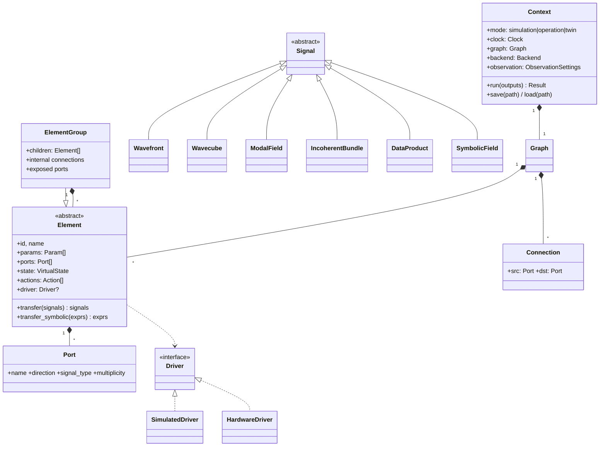
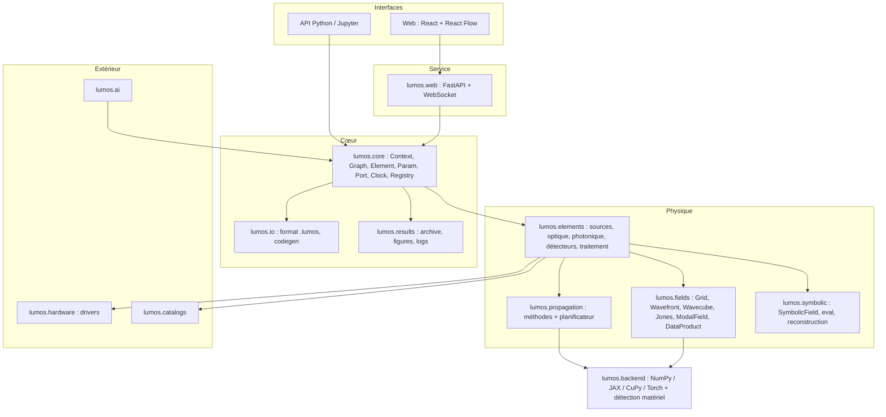

# LUMOS — Cahier des charges

> **LUM(os)²** — *Lumos is a Universal and Modular Optical Simulator & Operating System*
>
> Statut : **v0.1 (proposition)** — 2026-10-16 — à valider avant le démarrage du développement.
> Document compagnon : [plan_developpement.md](plan_developpement.md).

---

## Sommaire

1. [Contexte et objectifs](#1-contexte-et-objectifs)
2. [Retour d'expérience HELIOS (et PHISE)](#2-retour-dexpérience-helios-et-phise)
3. [Cas d'usage](#3-cas-dusage)
4. [Concepts fondamentaux](#4-concepts-fondamentaux)
5. [Exigences fonctionnelles](#5-exigences-fonctionnelles)
6. [Exigences non fonctionnelles](#6-exigences-non-fonctionnelles)
7. [Architecture logicielle](#7-architecture-logicielle)
8. [Conventions physiques et numériques](#8-conventions-physiques-et-numériques)
9. [Format de fichier `.lumos`](#9-format-de-fichier-lumos)
10. [Hors périmètre / limites assumées](#10-hors-périmètre--limites-assumées)
11. [Questions ouvertes](#11-questions-ouvertes)
12. [Glossaire](#12-glossaire)

Les exigences sont identifiées `REQ-<domaine>-<n>` et hiérarchisées :
**[M]** obligatoire (*must*), **[S]** souhaitable (*should*), **[C]** confort / ultérieur (*could*).

---

## 1. Contexte et objectifs

LUMOS succède à **HELIOS**, qui a servi de prototype pour délimiter le projet. LUMOS est une bibliothèque Python, accompagnée d'une interface web, qui :

1. **Simule** de bout en bout la propagation de la lumière, depuis une source (astronomique ou de laboratoire) jusqu'aux données détectées, à travers un système optique quelconque : optique de volume, optique guidée et photonique intégrée, interférométrie, coronographie, atmosphère, détecteurs.
2. **Pilote** les équipements optiques réels branchés à l'ordinateur (ex. Thorlabs) via la même description objet. Un même composant fonctionne en mode **simulation** ou en mode **opération**.
3. **Traite** les données, simulées ou réelles, au moyen de pipelines de blocs préconstruits : réduction, estimation de capacités de détection et de caractérisation.
4. **Infère** à terme (blocs IA) : calibration du système par comparaison réel/simulé, reconstruction de la scène observée à partir d'un a priori.

### Objectifs mesurables

| # | Objectif | Indicateur |
|---|----------|------------|
| O1 | Prédire la réponse instrumentale d'un système quelconque | Reproduire les démos HELIOS et les résultats PHISE (kernel-nuller) à la tolérance numérique près |
| O2 | Propager n'importe quelle grille vers n'importe quelle autre | Écart < 1e-3 (relatif, en énergie) par rapport à l'intégrale de Rayleigh-Sommerfeld directe sur la suite de validation |
| O3 | Exploiter le matériel au mieux | Sélection automatique CPU/GPU ; accélération ≥ ×10 sur GPU pour un Wavecube 2048² × 32 λ par rapport au CPU de référence |
| O4 | Deux interfaces équivalentes | Tout contexte construit dans le web s'exporte en `.lumos` et en script Python, et inversement |
| O5 | Résultats traçables | Chaque exécution archivée : contexte, métadonnées, logs, figures `.png` et `.plt` |

---

## 2. Retour d'expérience HELIOS (et PHISE)

L'analyse du dépôt HELIOS (≈ 13,8 k lignes Python, frontend React et backend FastAPI) permet de préciser la description initiale.

### 2.1 Acquis à conserver / porter

| Domaine | Acquis HELIOS | Devenir dans LUMOS |
|---------|---------------|--------------------|
| Exécution | Modèle **pull** (évaluation paresseuse depuis le détecteur) avec **cache** et **invalidation en aval** (`Layer._cached_output`, `Pipeline.invalidate_downstream_cache`) | Conservé, généralisé au graphe orienté (§5.4) |
| Propagation | `fraunhofer`, `fresnel` (1 FFT), `asm`, `scasm` (ASM mis à l'échelle par MFT), `rs_direct` (référence O(N⁴)), `fresnel_custom` (numba) ; état de l'art des bibliothèques dans `.github/copilot-instructions.md` ; pages « learn » de la doc | Réécrits et validés (§5.3) ; les pages « learn » sont reprises dans la doc |
| Sources | `Star`, `Planet` (thermique et réfléchie), `ExoZodiacal`, `Zodiacal`, `PlanetarySystem` (géométrie orbitale), corps noir modifié | Portés en éléments de type source |
| Catalogues | Chaîne de requêtes SIMBAD → VizieR (photométrie) → CALSPEC → ESO Phase 3 → VizieR étendu → IRSA/ISO → modèles Pickles, fusion de SED, cache JSON ; NASA Exoplanet Archive ; JPL Horizons ; spectre solaire ASTM E490 | Portés et refondus (§5.9) |
| Pupilles | Constructeur par primitives (disques, hexagones, obstruction, araignées, primaire segmenté), préréglages JWST/VLT/ELT, anti-crénelage par sur-échantillonnage | Porté |
| Interférométrie | `TelescopeArray` avec préréglages VLTI et LIFE, bases | Porté |
| Atmosphère / OA | Écran de phase von Kármán à écoulement figé (*frozen flow*), chromatique ; correction Zernike (indices de Noll) | Porté et rendu dépendant du temps du contexte |
| Coronographie | Masques 4QPM et vortex | Porté |
| Photonique | Simulateur MMI (solveur de modes par différences finies, gaine, Δn, calibration de phase, vidéos), modes LP de fibres, couplage multimode, TOPS, Y-splitter, `Swap` | Porté en éléments à matrice de diffusion et en modules physiques dédiés |
| Détecteur | Caméra avec bruit, *dark* et *binning* | Porté et enrichi |
| Web | Éditeur de graphe React Flow, configuration des nœuds, génération de code Python, préréglages, inspection d'un nœud, Docker | Refait sur une base pilotée par schéma (§5.11) |
| Visualisation | Export de diagramme UML de la chaîne, icônes SVG | Repris (vue « schéma » du contexte) |
| Docs | Sphinx + **Breeze** + MyST + Mermaid, ReadTheDocs | Conservé |
| Démos | 14 scripts et pages Streamlit numérotées | Convertis en notebooks et en préréglages web |

**PHISE** apporte en plus :
- le patron de **paramètre unitaire** : setter qui valide l'unité, stockage SI interne en `float`, mémorisation de l'unité utilisateur pour l'affichage, notification du parent pour invalider les calculs dérivés ; et `__slots__` ;
- des noyaux **numba `@njit`** pour les architectures de puces, une `Context` qui coordonne instrument et cible ;
- des modules qui deviendront des blocs de traitement : calibration (par essais-erreurs, par obstruction), statistiques de test, ROC, capacité de détection, cartes de transmission, ML.

### 2.2 Faiblesses identifiées (à corriger dès la conception)

1. **Pas de véritable graphe.** HELIOS utilise une liste de couches, éventuellement des listes parallèles, avec `num_inputs`/`num_outputs` implicites et un routage par ordre. Les chaînes N→M (puces photoniques) ou les recombinaisons y sont fragiles.
   → **Ports typés explicites et DAG** (REQ-CORE-*).
2. **Couplage par noms de classes.** `Pipeline.get_input_wavefront` fait des tests du type `type(layer).__name__ in ['Scene', 'PlanetarySystem']` : le moteur connaît les éléments concrets.
   → **Protocoles génériques** : une source implémente `emit()`, un détecteur `detect()`, etc.
3. **`Wavefront` hérite de `astropy.Quantity`.** Les métadonnées sont fragiles (`__array_finalize__`), les grilles carrées uniquement, le paramètre `size` ambigu, et le test interne contredit l'implémentation (forme `(1,128,128)` attendue pour un tableau 2D).
   → **Conteneur dédié** avec une `Grid` explicite, des tableaux sans unité et les unités portées par les métadonnées.
4. **Le polychromatisme est une liste Python** (`Spectrum = list[Wavefront]`), donc rien n'est vectorisé. Il n'y a pas de polarisation. Les positions des sources incohérentes dans `OpticalScene.render` ne sont **pas appliquées** (TODO).
   → **Wavecube vectorisé, Jones, modes incohérents** de première classe.
5. **La propagation n'est pas fiable dans toutes les configurations.** `fraunhofer` et `asm` **ignorent `Lf`** et se contentent de recadrer ou compléter. Le choix `auto` repose sur une heuristique simple. La lentille est intégrée à `propagate`. Les conventions de centrage diffèrent (`N//2` contre `(N-1)/2`, axe Y inversé dans le noyau numba).
   → **Planificateur de propagation** fondé sur les critères d'échantillonnage, des conventions uniques (§8) et une suite de validation.
6. **Les dépendances lourdes sont obligatoires** (poppy, hcipy, LightPipes, dLux dans `requirements.txt`) alors que leurs wrappers sont partiellement inopérants (branches `pass` dans `poppy_fresnel`).
   → **Extras optionnels**, utilisés comme références dans les tests plutôt que comme chemin d'exécution.
7. **Sécurité et hygiène des catalogues.** La vérification SSL est **désactivée globalement** par *monkeypatch* de `requests.Session.request`, un timeout socket est imposé globalement, le cache est écrit dans le dossier du paquet, les messages passent par `print`, des noms de cibles de démo sont codés en dur (« Betelgeuse », « K2-18 ») et les résultats sont des `dict` non typés.
8. **Peu de tests.** Il y a un seul fichier `tests/test_public_api.py` et des tests intégrés aux modules, sans validation physique systématique.
9. **Duplication dans le backend web.** `app.py` fait 1759 lignes, avec `scene_to_payload` / `*_to_payload` définis **trois fois** et `inspect_node` **deux fois**. Les *payloads* sont écrits à la main pour chaque composant.
   → **Interface générée depuis le registre d'éléments** (schéma JSON des paramètres et des ports).
10. **Sérialisation `to_dict`/`from_dict` écrite à la main**, avec résolution par `importlib.import_module(data["module"])`, ce qui revient à exécuter un module arbitraire désigné par un fichier.
    → **Registre d'éléments** à identifiants stables et liste blanche.
11. **Fonctions absentes :** modèle du temps, pilotage matériel, symbolique, GPU (hors dLux), différentiabilité.
12. **Modules monolithiques.** `sim/mmi.py` fait 1755 lignes et mêle physique, calibration, tracés et vidéo. Les 150+ journaux d'agent dans `.github/agent-logs/` documentent de nombreux refactorings successifs.
    → Séparation **physique / API élément / visualisation**, décisions d'architecture tracées dans des **ADR** courts, historique porté par git et un `CHANGELOG`.

---

## 3. Cas d'usage

| ID | Acteur | Cas d'usage |
|----|--------|-------------|
| UC1 | Astronome instrumentaliste | Construire un interféromètre à frange noire (VLTI + puce kernel-nuller), injecter une étoile issue des catalogues et sa planète, prédire les sorties et la carte de transmission |
| UC2 | Expérimentateur de banc | Décrire son banc (laser, lentilles, platines Thorlabs, puce, caméra), le simuler, puis basculer en mode opération pour faire une acquisition réelle avec la même séquence de commandes |
| UC3 | Expérimentateur de banc | Calibrer les phases d'une puce en mode opération et comparer en continu au jumeau numérique |
| UC4 | Étudiant / vulgarisation | Ouvrir l'interface web, charger le préréglage « Coronographe » et suivre le tutoriel pas à pas |
| UC5 | Développeur | Intégrer LUMOS dans un code plus large (boucle d'optimisation, étude paramétrique sur cluster) sans l'interface web |
| UC6 | Scientifique des données | Construire un pipeline de traitement (dark, empilement, estimateur, test statistique, ROC) et évaluer la capacité de détection en fonction de la séparation et du contraste |
| UC7 | Opticien | Comparer les méthodes de propagation et vérifier l'échantillonnage pour un système donné |
| UC8 | Chercheur (futur) | Reconstruire la scène (positions et flux des compagnons) à partir de données réelles et d'un a priori décrit comme un `ElementGroup` paramétré |

---

## 4. Concepts fondamentaux



- **Element** : tout objet du système (source, composant optique, détecteur, nœud de calcul, bloc IA). Il porte des **paramètres** (`Param`, avec unités), des **ports** typés, un **état virtuel**, une **fonction de transfert** numérique et, en option, symbolique, des **actions** (commandes, éventuellement temporisées) et, en option, un **driver** matériel.
- **ElementGroup** : élément composite (cible = étoile + planètes, puce = sous-composants…) qui expose certains ports internes comme ses propres ports. Imbrication libre.
- **Graph** : graphe orienté acyclique d'éléments reliés par des **connexions** port → port.
- **Signal** : ce qui circule sur une connexion (champ optique, données, scalaires…).
- **Context** : conteneur et coordinateur (graphe, horloge, mode, backend de calcul, paramètres d'observation, journal, graines aléatoires).

---

## 5. Exigences fonctionnelles

### 5.1 Éléments, paramètres et modes

| ID | Prio | Exigence |
|----|------|----------|
| REQ-EL-1 | M | Tout équipement ou bloc est une classe dérivée de `Element`. Ses paramètres sont déclarés de façon **déclarative** (`Param(unit=u.m, default=…, bounds=…, doc=…)`), ce qui donne automatiquement la validation d'unité, le stockage interne SI performant, la sérialisation, le schéma JSON (pour le web) et l'invalidation du cache aval à la modification. |
| REQ-EL-2 | M | L'utilisateur manipule des `astropy.units.Quantity` ; l'unité saisie est conservée pour l'affichage (patron PHISE). |
| REQ-EL-3 | M | Chaque paramètre peut être marqué **libre** (`free=True`), avec un **a priori** optionnel (distribution) et des bornes. C'est le prérequis de la calibration et de l'inférence (§5.13). |
| REQ-EL-4 | M | Deux modes d'opération : **simulation** et **opération**, définis au niveau du `Context`. On peut déclarer une **dérogation** pour un élément donné (ex. pas de driver disponible : élément purement simulé). |
| REQ-EL-5 | M | **Actions.** Méthodes décorées (`@action(duration=…)`) qui modifient l'état de l'équipement (déplacer une platine, régler une phase, lancer une pose). En simulation, aucune commande réelle n'est envoyée : la commande est **journalisée**, l'**état virtuel** est mis à jour et l'horloge du contexte avance de la durée de l'action. En opération, la commande part vers le driver, l'état est relu depuis l'équipement, et la durée réelle est mesurée et enregistrée. |
| REQ-EL-6 | M | La durée d'une action est soit fixe, soit **calculée depuis les propriétés** de l'objet (ex. `distance / vitesse + accélération`, temps de pose + lecture). |
| REQ-EL-7 | S | Mode **jumeau** (*twin*) : en opération, chaque commande est aussi appliquée au modèle simulé, et les sorties réelles et simulées sont produites côte à côte. C'est la base de UC3 et de la calibration IA. |
| REQ-EL-8 | M | Un élément qui agit sur le front d'onde fournit une **fonction de transfert numérique** acceptant `Wavefront` et `Wavecube` (polarisés ou non). Elle est vectorisée sur les longueurs d'onde et les modes incohérents. |
| REQ-EL-9 | S | Un élément peut fournir une **fonction de transfert symbolique** (expression d'entrée → expression de sortie). À défaut, le moteur bascule sur la voie numérique (§5.5). |
| REQ-EL-10 | M | Les fonctions de transfert numériques sont **pures** : pas d'effet de bord, paramètres explicites. C'est indispensable pour la JIT, le parallélisme et la différentiation automatique. |
| REQ-EL-11 | M | Introspection : `describe()` (arbre textuel), `schema()` (JSON Schema), représentation riche dans Jupyter. |
| REQ-EL-12 | M | Import/export **individuel** d'un élément ou d'un groupe en `.lumos` (§9). |

### 5.2 Signaux et représentations du champ

| ID | Prio | Exigence |
|----|------|----------|
| REQ-SIG-1 | M | `Grid` : échantillonnage 2D **rectangulaire** (`nx ≠ ny` autorisé), pas `dx, dy`, centre décalable, nature du plan (spatial en m, ou angulaire en rad), convention de centrage unique (§8). |
| REQ-SIG-2 | M | `Wavefront` : champ complexe discret sur une `Grid` à une longueur d'onde. Il expose `intensity`, `amplitude`, `phase`, `power`. Stockage : tableau du backend courant, sans unité ; l'unité du champ est en métadonnée (normalisation : `|E|²` en W/m² ou en photons/s/m²). |
| REQ-SIG-3 | M | `Wavefront` polarisé : composantes de Jones `(Ex, Ey)` (forme `(2, ny, nx)`). Les éléments polarisants agissent par matrices de Jones (éventuellement variables dans l'espace). |
| REQ-SIG-4 | M | `Wavecube` : pile de fronts d'onde sur un axe spectral (forme `(nλ, [2,] ny, nx)`), avec poids spectraux (densité spectrale de la source). La grille est commune à toutes les longueurs d'onde, ce que la propagation grille-à-grille (MFT/CZT) permet de garantir en plan focal. |
| REQ-SIG-5 | M | `IncoherentBundle` : ensemble de modes **mutuellement incohérents** (sources ponctuelles d'une scène, modes de cohérence partielle, polarisation partielle). La propagation est vectorisée sur l'axe des modes, et la somme se fait **en intensité** à la détection. Cela corrige le TODO de `OpticalScene`. |
| REQ-SIG-6 | M | `ModalField` : amplitudes complexes par guide d'onde ou par mode (optique guidée, puces), vectorisées sur λ et sur les modes incohérents. Les composants photoniques agissent par **matrices de diffusion** (S-matrices), éventuellement dépendantes de λ. |
| REQ-SIG-7 | M | Conversions : couplage `Wavefront → ModalField` par intégrales de recouvrement avec les modes (fibres, guides : modes LP, gaussiens) et `ModalField → Wavefront` (sortie de fibre). |
| REQ-SIG-8 | M | `DataProduct` : données détectées (image, cube, série temporelle, scalaires) avec unités (ADU, e⁻, photons), axes physiques, masque, incertitudes et métadonnées d'acquisition. Exportable en FITS, NPZ ou HDF5. |
| REQ-SIG-9 | M | `SymbolicField` : expression symbolique du champ (§5.5). |
| REQ-SIG-10 | M | Tous les signaux sont **typés** sur les ports. La connexion de deux ports incompatibles est refusée, ou proposée avec un convertisseur explicite. |

### 5.3 Propagation numérique (plan discret → plan discret)

| ID | Prio | Exigence |
|----|------|----------|
| REQ-PROP-1 | M | Propagation de **n'importe quelle grille** (résolution, taille, centre) vers **n'importe quelle autre**, pour toute distance (y compris z = 0, z < 0 rétro-propagation, z → ∞) et toute longueur d'onde. |
| REQ-PROP-2 | M | Méthodes implémentées : Fraunhofer (FFT) ; **MFT** (*Matrix Fourier Transform*, Soummer et al. 2007) pour un échantillonnage focal arbitraire ; Fresnel en fonction de transfert et en réponse impulsionnelle (1 FFT) ; Fresnel en deux étapes (changement d'échelle) ; **ASM** à bande limitée (Matsushima & Shimobaba 2009) ; ASM mis à l'échelle ou décalé (MFT ou *chirp-z*) ; Rayleigh-Sommerfeld par convolution FFT ; Rayleigh-Sommerfeld **direct** (référence, coûteux) ; transformée pupille ↔ plan focal (lentille idéale de focale f). |
| REQ-PROP-3 | M | **Planificateur** (`plan_propagation(grid_in, grid_out, z, λ)`) : il calcule le nombre de Fresnel, les critères d'échantillonnage (repliement du noyau, critère de Voelz & Roggemann `dx_in·dx_out = λz/N`), le rembourrage nécessaire et le coût estimé (mémoire, FLOP) sur le matériel détecté. Il choisit la méthode **la plus efficace qui respecte la tolérance** demandée. Le choix et les avertissements (sous-échantillonnage, repliement) sont journalisés ; l'utilisateur peut imposer une méthode. |
| REQ-PROP-4 | M | Conservation de l'énergie (Parseval) vérifiée en test pour chaque méthode, avec une normalisation physique cohérente entre méthodes. |
| REQ-PROP-5 | M | Vectorisation native sur λ (Wavecube), sur la polarisation et sur les modes incohérents. Le planificateur réutilise les noyaux pré-calculés quand c'est possible (cache des matrices MFT et des fonctions de transfert). |
| REQ-PROP-6 | M | La lentille, le miroir et le masque sont des **éléments**, pas des options de `propagate` (contrairement à HELIOS). |
| REQ-PROP-7 | S | Propagation **différentiable** (backend JAX) : gradients par rapport aux paramètres des éléments et au champ d'entrée. |
| REQ-PROP-8 | C | Méthodes avancées : BPM (*beam propagation method*) pour les milieux inhomogènes et l'optique guidée ; diffraction vectorielle de Richards-Wolf (forte ouverture numérique) ; tracé de rayons (ABCD et rayons réels) pour la conception géométrique. |
| REQ-PROP-9 | S | Les bibliothèques externes (POPPY, HCIPy, PROPER, dLux, LightPipes) servent de **références de validation** et d'adaptateurs optionnels (extras), jamais de dépendances obligatoires. |

### 5.4 Contexte, graphe et exécution

| ID | Prio | Exigence |
|----|------|----------|
| REQ-CTX-1 | M | Le `Context` contient et coordonne tous les éléments : sources, optiques, détecteurs, nœuds de calcul, blocs IA. |
| REQ-CTX-2 | M | Graphe orienté **acyclique** au niveau des signaux. Les boucles physiques (boucle d'OA, asservissement, calibration itérative) sont exprimées comme des **itérations temporelles** pilotées par le contexte, pas comme des cycles du graphe. |
| REQ-CTX-3 | M | API Python fluide : `ctx.add(elem)`, `ctx.connect(a.out, b.in_)`, `a >> b` (raccourci quand les ports sont uniques), indexation par nom (`ctx["telescope.pupil"]`). |
| REQ-CTX-4 | M | Exécution **pull** : `ctx.run(outputs=[...])` ne calcule que le sous-graphe nécessaire, dans un ordre topologique, avec cache par port et invalidation en aval à chaque modification de paramètre ou d'état (acquis HELIOS). |
| REQ-CTX-5 | M | **Horloge** (`Clock`) : date de début (`astropy.time.Time`) et temps écoulé. Avancée par les actions (§5.1) ou explicitement (`ctx.wait(10*u.s)`). Les éléments dépendants du temps (atmosphère à écoulement figé, rotation de champ, orbites, dérives thermiques) lisent `ctx.time`. Les actions simultanées (`with ctx.parallel():`) avancent l'horloge du maximum de leurs durées. |
| REQ-CTX-6 | M | Paramètres d'observation globaux : échantillonnage spectral (bande, nλ), site (latitude, longitude, altitude), pointage, angle horaire, graines aléatoires. |
| REQ-CTX-7 | M | `ElementGroup` : se comporte comme un élément (ports exposés, paramètres agrégés, sérialisation). Il peut être réduit ou déplié dans le web et peut **résumer** son comportement par une matrice de transfert globale si ses enfants sont linéaires. |
| REQ-CTX-8 | M | Import/export du contexte entier en `.lumos` (§9). Génération d'un **script Python équivalent** (acquis HELIOS). |
| REQ-CTX-9 | M | Journal structuré (`ctx.log`) : commandes, changements d'état, choix des méthodes de propagation, avertissements physiques, durées de calcul. Il s'appuie sur le module `logging` standard (aucun `print`). |
| REQ-CTX-10 | S | Balayages paramétriques et Monte-Carlo : `ctx.sweep({param: values})` est parallélisé (vectorisation, `vmap` JAX, ou processus). |
| REQ-CTX-11 | S | Vue « schéma » : export d'un diagramme du graphe en SVG ou PNG (successeur de `uml_export`). |

### 5.5 Symbolique

| ID | Prio | Exigence |
|----|------|----------|
| REQ-SYM-1 | M | `SymbolicField` : expression SymPy du champ complexe en fonction de variables canoniques (`x, y` ou `θx, θy`, `λ`, `t`) et de paramètres nommés (liés aux `Param` des éléments), avec domaine de validité et plan. |
| REQ-SYM-2 | M | **Symbols → grid** : évaluation sur une `Grid` (→ `Wavefront`), ou sur une `Grid` × axe spectral (→ `Wavecube`) si l'expression dépend de λ. Compilation par `lambdify` vers le backend courant (NumPy, JAX, CuPy), mise en cache. **Anti-crénelage** pour les fonctions discontinues (ouvertures) par sur-échantillonnage et intégration par pixel (acquis « soft » de HELIOS). |
| REQ-SYM-3 | M | **Grid → symbols**, plusieurs méthodes : projection sur bases orthogonales (Zernike, Hermite-Gauss, Laguerre-Gauss, modes LP, Fourier) avec troncature contrôlée par l'erreur résiduelle ; ajustement de modèles paramétriques (faisceau gaussien, paramètre q complexe, Airy) ; régression parcimonieuse sur un dictionnaire de fonctions. En option, régression symbolique (PySR). Chaque reconstruction renvoie l'expression et une métrique d'erreur. |
| REQ-SYM-4 | M | **Propagation symbolique** : chaînage des fonctions de transfert symboliques des éléments (substitution de l'expression d'entrée). Les formes closes sont exploitées quand elles existent : faisceaux gaussiens, HG et LG via matrices ABCD, transformées de Fourier tabulées (circ → Airy, rect → sinc). |
| REQ-SYM-5 | M | **Repli explicite** : si une intégrale n'a pas de forme close ou si la simplification dépasse un délai, le moteur échantillonne l'expression (symbols → grid), propage numériquement, et peut reconstruire une expression (grid → symbols) si demandé. Le journal l'indique. |
| REQ-SYM-6 | S | Les expressions symboliques des éléments servent aussi à la documentation (rendu LaTeX dans Jupyter, dans la doc et dans le web). |

### 5.6 Calcul haute performance et matériel

| ID | Prio | Exigence |
|----|------|----------|
| REQ-HPC-1 | M | **Abstraction de backend** (Array API) : un même code pour NumPy (référence CPU), JAX (CPU/GPU/TPU, JIT, autodiff), CuPy (GPU CUDA) et, en option, PyTorch. Les données des objets LUMOS sont des tableaux du backend, sans unités. |
| REQ-HPC-2 | M | **Détection du matériel** au démarrage, ou à la demande avec `lumos.hardware_report()` : OS, CPU (cœurs, jeux d'instructions), RAM, GPU (modèle, VRAM, CUDA/ROCm/Metal), bibliothèques disponibles. **Sélection automatique** du backend et du nombre de *threads* FFT, que l'utilisateur peut forcer (`lumos.config.backend = "jax"`). |
| REQ-HPC-3 | M | Chaque fonction coûteuse est compilée avec la technique la plus adaptée : JIT JAX (`jit`, `vmap`) pour les noyaux vectorisables et différentiables, `numba` pour les boucles CPU non vectorisables, extension C++ (nanobind) seulement si le profilage le justifie. Le choix est documenté par un ADR. |
| REQ-HPC-4 | M | **Gestion mémoire** : estimation préalable, découpage automatique (*chunking*) sur λ et sur les modes quand la VRAM ou la RAM est insuffisante. |
| REQ-HPC-5 | M | Précision configurable (`complex64` / `complex128`), `complex128` par défaut sur CPU. |
| REQ-HPC-6 | S | Suite de *benchmarks* reproductible (pytest-benchmark ou asv) suivie dans le temps. |
| REQ-HPC-7 | C | Exécution distribuée (multi-GPU, cluster via Dask ou Ray) pour les balayages. |

### 5.7 Pilotage d'équipements (mode opération)

| ID | Prio | Exigence |
|----|------|----------|
| REQ-HW-1 | M | Interface `Driver` : `connect`, `disconnect`, `send(command)`, `query(property)`, `status`, `stop`. `SimulatedDriver` journalise les commandes et renvoie l'état virtuel. Les drivers réels implémentent la même interface. |
| REQ-HW-2 | M | **Découverte** des équipements connectés (USB, série, VISA, SDK constructeurs) et association à des éléments. |
| REQ-HW-3 | M | Premiers drivers visés : Thorlabs (platines Kinesis, contrôleurs piézo, puissance-mètres PM, caméras scientifiques TSI), via `pylablib`, `thorlabs-apt-protocol`, Kinesis .NET (pythonnet) ou les SDK officiels selon disponibilité. Générique : SCPI/VISA (`pyvisa`), série. |
| REQ-HW-4 | M | **Sécurité** : bornes logicielles sur chaque paramètre actionnable, **arrêt d'urgence** global (`ctx.stop_all()`), confirmation des actions marquées dangereuses, mode *dry-run*, délais d'attente et reprise sur erreur. Une interruption Python (Ctrl+C) laisse les équipements dans un état sûr. |
| REQ-HW-5 | M | En opération, les données réelles sont produites sous forme de `DataProduct`, identiques à celles de la simulation (mêmes ports) : un pipeline de traitement fonctionne indifféremment sur des données réelles ou simulées. |
| REQ-HW-6 | S | Enregistrement d'une **séquence** d'actions (script ou web) pour la rejouer en simulation puis en opération. |
| REQ-HW-7 | S | Architecture de plugins : un driver tiers se déclare via les *entry points* Python, sans modification du cœur. |

### 5.8 Bibliothèque d'éléments (v1)

| Famille | Éléments |
|---------|----------|
| Sources | Source ponctuelle (spectre arbitraire), `Star` (corps noir, Pickles, SED catalogue), `Planet` (thermique et réfléchie, phase orbitale), système planétaire (`ElementGroup`), exo-zodi, zodi local, scène étendue (image ou cube), laser (gaussien, monomode), LED ou lampe (incohérente), source symbolique |
| Environnement | Atmosphère (couches von Kármán, écoulement figé, chromatique, scintillation optionnelle), vide |
| Collecte / échantillonnage | Pupille paramétrique (préréglages JWST, VLT, ELT…), télescope, réseau de télescopes (VLTI, LIFE…), diaphragmes, masques |
| Optique de volume | Lentille ou miroir mince (et épaisse via ABCD), propagation en espace libre, séparatrice, lame de phase, polariseur, lames d'onde, déphaseur, filtre spectral, miroir déformable (Zernike, actionneurs), coronographes (4QPM, vortex, Lyot), ligne à retard |
| Optique guidée | Fibre monomode et multimode (modes LP), injection et extraction |
| Photonique intégrée | Guide, déphaseur thermo-optique, Y-splitter, coupleur directionnel, MMI (via le solveur porté de HELIOS), croisement, puce = `ElementGroup` de S-matrices ; préréglages kernel-nuller (architectures PHISE) |
| Détection | Caméra (QE(λ), bruits de lecture, d'obscurité et de photons, gain, saturation, binning, temps de pose), photodiode, puissance-mètre, spectrographe (dispersion simple) |
| Calcul / données | Voir §5.10 |

### 5.9 Catalogues astronomiques

| ID | Prio | Exigence |
|----|------|----------|
| REQ-CAT-1 | M | `lumos.catalogs.resolve("<nom>")` identifie le type d'objet (étoile, exoplanète, corps du Système solaire) et renvoie un **objet typé** (`StarRecord`, `ExoplanetRecord`, …). Champs avec unités, incertitudes et **provenance par champ** (catalogue, date de requête). |
| REQ-CAT-2 | M | Sources portées de HELIOS : SIMBAD, VizieR (photométrie et spectres), CALSPEC (STScI), ESO Phase 3, IRSA/ISO, modèles Pickles, NASA Exoplanet Archive, JPL Horizons, spectre solaire ASTM E490. Ajouts visés : Gaia DR3, SVO Filter Profile Service (bandes photométriques), MAST, exoplanet.eu. |
| REQ-CAT-3 | M | Fusion de SED multi-sources avec règles de priorité documentées, et complétion physique optionnelle (Teff depuis le type spectral, etc.), signalée comme estimée. |
| REQ-CAT-4 | M | Cache dans le répertoire utilisateur (`platformdirs`) avec durée de vie configurable, mode **hors-ligne**, vidage du cache. **Vérification TLS toujours active.** Les timeouts sont fixés par requête, jamais en global. |
| REQ-CAT-5 | M | `Star.from_catalog("Vega")`, `Planet.from_catalog("HD 209458 b")`, `PlanetarySystem.from_catalog("TRAPPIST-1")` construisent directement des éléments ou des groupes. |
| REQ-CAT-6 | S | Fournisseurs de catalogues extensibles via un système de plugins. |

### 5.10 Pipelines de traitement de données

| ID | Prio | Exigence |
|----|------|----------|
| REQ-PIPE-1 | M | Les blocs de traitement sont des `Element` à ports `DataProduct` ; ils se branchent dans le même graphe que l'optique. |
| REQ-PIPE-2 | M | Blocs v1 : soustraction du dark, champ plat, empilement, recadrage et rééchantillonnage, photométrie d'ouverture, profil radial, contraste, profondeur de nulling, kernels (combinaisons de sorties), estimation du rapport signal sur bruit. |
| REQ-PIPE-3 | M | Évaluation des **capacités de détection et de caractérisation** (portage de PHISE) : statistiques de test, courbes ROC, courbes de contraste limite, cartes de transmission. |
| REQ-PIPE-4 | S | Bloc « script » : fonction Python utilisateur encapsulée en bloc, avec ports déclarés. |
| REQ-PIPE-5 | S | Blocs d'analyse de calibration : ajustement de phases (portage de PHISE, essais-erreurs et génétique, et de HELIOS pour les MMI). |

### 5.11 Interface web (programmation visuelle)

| ID | Prio | Exigence |
|----|------|----------|
| REQ-WEB-1 | M | Éditeur de graphe : ajouter, supprimer et déplacer des blocs, connecter les ports, avec vérification de type à la connexion et couleurs par type de signal. |
| REQ-WEB-2 | M | **Palette et formulaires générés** depuis le registre d'éléments (schéma JSON des paramètres, des ports, des unités et de la documentation). Aucun code par composant côté web ou backend. |
| REQ-WEB-3 | M | Saisie des paramètres avec unités (sélecteur d'unité, conversion), validation des bornes et documentation contextuelle. |
| REQ-WEB-4 | M | `ElementGroup` : créer un groupe par sélection, le réduire ou le déplier, l'enregistrer comme bloc réutilisable. |
| REQ-WEB-5 | M | Exécution : lancement, progression et logs en direct (WebSocket), **inspection** de la sortie de n'importe quel port (intensité, phase, spectre, données), téléchargement des résultats (`.png`, `.plt`, données, archive). |
| REQ-WEB-6 | M | Import/export `.lumos` (contexte, élément ou groupe) et génération du script Python équivalent. |
| REQ-WEB-7 | M | **Préréglages** (les mêmes fichiers `.lumos` que les notebooks d'exemple) et **tutoriel** pas à pas superposé à l'interface. |
| REQ-WEB-8 | M | Mode opération accessible depuis le web **uniquement** quand le backend tourne en local (liaison à `localhost`), avec confirmation explicite. Aucun pilotage matériel depuis une instance publique. |
| REQ-WEB-9 | S | Recherche d'objets astronomiques intégrée (catalogues) pour créer une source. |
| REQ-WEB-10 | S | Internationalisation FR/EN (acquis HELIOS : `i18n.js`). |
| REQ-WEB-11 | S | Déploiement par Docker (instance de démonstration publique en mode simulation seulement, avec quotas de calcul). |

### 5.12 Résultats, figures et archivage

| ID | Prio | Exigence |
|----|------|----------|
| REQ-RES-1 | M | Chaque `ctx.run(...)` peut produire une **archive** via `vfst.archive` (VFSciTools), créée **à côté du script ou du notebook exécuté** (répertoire du `__main__`, ou répertoire courant du noyau Jupyter). Racine configurable. |
| REQ-RES-2 | M | L'archive contient : `context.lumos` (contexte exact utilisé), `metadata.yml` (date et heure UTC, OS, version de Python, versions de LUMOS et des dépendances clés, git commit et branche, matériel détecté, backend et précision, graines, durées, mode, horloge simulée début et fin), `lumos.log` (journal complet), `figures/` et `data/`. |
| REQ-RES-3 | M | Figures **scientifiquement exploitables** : axes avec grandeurs et unités, barres de couleur étiquetées, cartes de couleurs perceptuellement uniformes (cyclique pour la phase), style homogène (feuille de style LUMOS), tailles adaptées aux publications. |
| REQ-RES-4 | M | Export de chaque figure en `.png` et en `.plt` (`pltedit.save`), pour l'éditer ensuite dans PltEdit. |
| REQ-RES-5 | M | Les données numériques sous-jacentes aux figures sont sauvegardées (reproductibilité indépendante de matplotlib). |
| REQ-RES-6 | S | Rechargement d'une archive : `lumos.load_archive(path)` restitue le contexte, les résultats et les métadonnées. |

### 5.13 Blocs IA (à terme)

| ID | Prio | Exigence |
|----|------|----------|
| REQ-AI-1 | C | Blocs de traitement appris (débruitage, détection, classification), entraînables sur des jeux de données **générés par LUMOS** (balayage des paramètres libres et de leurs a priori). |
| REQ-AI-2 | C | **Calibration** du système optique : ajustement des paramètres libres du modèle simulé pour reproduire les données réelles (mode jumeau), par gradient (simulation différentiable JAX) ou sans gradient. |
| REQ-AI-3 | C | **Reconstruction de scène** : à partir d'un a priori (groupe paramétré : nombre de compagnons, positions, flux…), inférence bayésienne (MCMC ou HMC via NumPyro/BlackJAX) ou inférence par simulation (*simulation-based inference*, bibliothèque `sbi`). |
| REQ-AI-4 | C | Modèles de substitution (*surrogates*) appris pour accélérer les sous-graphes coûteux. |

> Les exigences REQ-EL-3 (paramètres libres et a priori), REQ-EL-10 (transferts purs) et REQ-PROP-7 (différentiabilité) sont **obligatoires dès la v1** précisément pour que §5.13 n'impose pas de refonte.

### 5.14 Exemples, tutoriels, documentation

| ID | Prio | Exigence |
|----|------|----------|
| REQ-DOC-1 | M | Documentation Sphinx hébergée sur **ReadTheDocs**, thème **Breeze** (`sphinx-breeze-theme`, https://github.com/aksiome/breeze), MyST Markdown, Mermaid, autodoc et autosummary (docstrings NumPy). |
| REQ-DOC-2 | M | Sections : *Getting started*, *User guide* (concepts), *Learn* (physique : méthodes de propagation, échantillonnage, photonique, détecteurs ; pages reprises de HELIOS), *Examples* (notebooks rendus), *API*, *Hardware* (drivers supportés), *Web*, *Contributing*, *ADR*. |
| REQ-DOC-3 | M | Notebooks Jupyter explicatifs numérotés dans `examples/`, **exécutés en CI** (ils ne doivent jamais casser) et intégrés à la doc (myst-nb ou nbsphinx). |
| REQ-DOC-4 | M | Chaque préréglage web correspond à un notebook et à un fichier `.lumos` partagé. |
| REQ-DOC-5 | M | Les docstrings expliquent la **physique** (formules, hypothèses, références bibliographiques), pas seulement le code (philosophie pédagogique HELIOS). |

---

## 6. Exigences non fonctionnelles

| ID | Prio | Exigence |
|----|------|----------|
| NF-1 | M | Python ≥ 3.12 ; Windows, Linux et macOS (le pilotage matériel cible d'abord Windows) |
| NF-2 | M | Dépendances de base minimales : `numpy`, `scipy`, `astropy`, `sympy`, `matplotlib`, `pyyaml`, `platformdirs`, `array-api-compat`, `vfscitools`. Extras : `[jax]`, `[gpu]` (cupy), `[torch]`, `[catalogs]` (astroquery, requests), `[hardware]` (pylablib, pyvisa, pythonnet), `[web]` (fastapi, uvicorn), `[ai]`, `[validation]` (poppy, hcipy…), `[docs]`, `[dev]` |
| NF-3 | M | Tests (`pytest`) : unitaires, d'**intégration** (contextes complets) et **physiques** (conservation de l'énergie, premier zéro d'Airy à 1,22 λ/D, faisceau gaussien comparé à l'analytique, réciprocité, cohérence entre méthodes de propagation, comparaison à POPPY et HCIPy). Couverture ≥ 85 % sur `core`, `fields` et `propagation`. |
| NF-4 | M | CI GitHub Actions : lint (ruff), typage (mypy ou pyright, mode strict sur le cœur), tests sur matrice OS × Python, exécution des notebooks, construction de la doc ; tests GPU sur exécuteur dédié ou déclenchement manuel |
| NF-5 | M | Versionnage sémantique, `CHANGELOG`, publication PyPI par *trusted publishing* sur Release GitHub (comme VFSciTools) |
| NF-6 | M | **Reproductibilité** : graines explicites, version du format `.lumos`, métadonnées d'archive complètes |
| NF-7 | M | **Sécurité** : pas de `pickle` ni d'import arbitraire au chargement d'un `.lumos` (registre en liste blanche) ; TLS vérifié ; backend web sans pilotage matériel en mode public ; aucun secret dans les fichiers de contexte |
| NF-8 | M | Licence MIT (cohérent avec HELIOS, PHISE et VFSciTools) |
| NF-9 | S | Temps d'import de `lumos` < 1 s (imports paresseux des backends lourds) |
| NF-10 | M | Code, docstrings et commentaires en anglais ; documentation en anglais (traduction FR possible ultérieurement) |
| NF-11 | M | Décisions d'architecture tracées en **ADR** courts (`docs/adr/NNNN-titre.md`) |

---

## 7. Architecture logicielle

### 7.1 Vue en couches



### 7.2 Arborescence cible

```
LUMOS/
├── src/lumos/
│   ├── __init__.py          # API publique, imports paresseux
│   ├── config.py            # configuration globale (backend, précision, cache, logs)
│   ├── units.py             # helpers astropy, Param, conversions SI
│   ├── backend/             # array API, FFT, JIT, détection matériel
│   ├── core/                # Element, Param, Port, Signal, Graph, Context, Clock, Action, Registry
│   ├── fields/              # Grid, Wavefront, Wavecube, Jones, IncoherentBundle, ModalField, DataProduct
│   ├── propagation/         # fraunhofer, mft, fresnel, asm, rs, planner
│   ├── symbolic/            # SymbolicField, lambdify, bases modales, reconstruction
│   ├── elements/
│   │   ├── sources/  environment/  apertures/  optics/
│   │   ├── guided/   photonics/    detectors/  processing/
│   ├── physics/             # modules physiques purs (solveur MMI, modes LP, SED, orbites…)
│   ├── hardware/            # Driver, SimulatedDriver, thorlabs/, visa/, discovery
│   ├── catalogs/            # providers/, records, cache
│   ├── io/                  # .lumos (schéma, migrations), codegen Python
│   ├── results/             # archive (vfst), figures (pltedit), style, logs
│   ├── plotting/            # tracés scientifiques standard
│   ├── ai/                  # (ultérieur)
│   └── web/                 # backend FastAPI
├── web/                     # frontend (React, Vite, @xyflow/react)
├── examples/                # notebooks numérotés + presets/*.lumos
├── tests/  unit/ physics/ integration/ hardware/ benchmarks/
├── docs/   (Sphinx Breeze) + adr/ + specs/
├── .github/workflows/
├── pyproject.toml  CHANGELOG.md  CLAUDE.md  LICENSE  README.md
```

### 7.3 Choix technologiques proposés

| Besoin | Choix proposé | Justification |
|--------|---------------|---------------|
| Unités | `astropy.units` à la frontière ; SI `float` en interne | Exigé ; patron PHISE éprouvé |
| Tableaux | `array-api-compat` sur NumPy, JAX, CuPy, Torch | Un seul code, plusieurs backends |
| Backend différentiable | **JAX** | JIT, `vmap`, autodiff, GPU ; écosystème optique (dLux) et inférence (NumPyro, BlackJAX) |
| Boucles CPU | `numba` | Acquis HELIOS et PHISE ; utile hors JAX |
| Extension native | C++ via `nanobind`, seulement si besoin mesuré | Mojo écarté pour l'instant (empaquetage et écosystème Python encore immatures) — à réévaluer |
| Symbolique | `sympy` (+ `lambdify`) ; `pysr` en option | Standard, compilable vers NumPy et JAX |
| Graphe | Implémentation interne légère (DAG, tri topologique) | Évite une dépendance pour un besoin simple ; `networkx` seulement pour l'analyse et le tracé |
| Sérialisation | JSON + schéma JSON versionné ; tableaux en *sidecar* `.npz` | Exigence `.lumos`, lisible, sûr |
| Web backend | FastAPI + WebSocket + Pydantic | Acquis HELIOS |
| Web frontend | React + Vite + `@xyflow/react` (React Flow v12) + Tailwind ; tutoriel par `driver.js` (ou équivalent) | Acquis HELIOS, version maintenue |
| Matériel | `pylablib`, `pyvisa`, SDK Thorlabs / Kinesis (`pythonnet`) | Couvre la majorité des équipements de laboratoire |
| Catalogues | `astroquery`, `pyvo`, `requests` | Acquis HELIOS |
| Archivage, figures | `vfscitools` (`vfst.archive`, `pltedit`) | Exigé |
| Docs | Sphinx + `sphinx-breeze-theme` + MyST + `myst-nb` | Exigé, acquis HELIOS |

---

## 8. Conventions physiques et numériques

À figer dans la doc (*User guide → Conventions*) et à tester :

- **Onde** : `E(r, t) = Re{U(r) e^{-iωt}}`, propagation selon +z, `U ∝ e^{+ikz}`. Une lentille convergente de focale f applique `exp(-i k r² / 2f)`.
- **Tableaux** : indexation `[..., y, x]`, origine des tracés en bas à gauche (`origin="lower"`), x vers la droite et y vers le haut.
- **Centrage** : le pixel central est l'indice `N // 2` (convention FFT, compatible `fftshift`) pour N pair comme impair. Coordonnées `x_i = (i - N//2)·dx + x0`.
- **Normalisation du champ** : `Σ |U|² dx dy` = puissance (W ou photons/s). Les méthodes de propagation conservent cette quantité aux pertes physiques près (troncature, évanescence).
- **Plans angulaires** : coordonnées en rad, avec conversion vers le plan focal par `x = f·θ`.
- **Spectral** : λ dans le vide ; les éléments dispersifs reçoivent λ et l'indice n(λ) (modèles de Sellmeier).
- **Polarisation** : base (x, y) du laboratoire ; matrices de Jones agissant sur `(Ex, Ey)`.
- **Temps** : `astropy.time.Time` (UTC) pour la date absolue, `Quantity` pour les durées.

---

## 9. Format de fichier `.lumos`

Fichier JSON UTF-8, éventuellement accompagné d'un dossier ou d'une archive *sidecar* pour les gros tableaux.

```json
{
  "lumos_format": "1.0",
  "kind": "context",
  "lumos_version": "0.1.0",
  "created_at": "2026-10-16T09:00:00Z",
  "meta": {"name": "VLTI kernel-nuller", "description": "...", "author": "..."},
  "context": {
    "mode": "simulation",
    "clock": {"start": "2026-10-16T00:00:00", "elapsed": {"value": 0, "unit": "s"}},
    "observation": {"band": {"min": {"value": 3.5, "unit": "um"}, "max": {"value": 4.1, "unit": "um"}, "n": 16}},
    "backend": {"preferred": "auto", "precision": "complex128"},
    "seed": 42
  },
  "elements": [
    {"id": "star", "type": "lumos.sources.Star", "type_version": 1, "name": "Vega",
     "params": {"temperature": {"value": 9602, "unit": "K"}, "magnitude": {"value": 0.03, "unit": "mag"}},
     "state": {}},
    {"id": "chip", "type": "lumos.group", "children": ["..."], "connections": ["..."],
     "exposed_ports": {"in1": "mmi1.in1"}}
  ],
  "connections": [{"from": "star.out", "to": "vlti.in"}],
  "ui": {"positions": {"star": [0, 0]}, "viewport": {}},
  "arrays": {"pupil_mask": {"$ref": "sidecar.npz#pupil_mask", "dtype": "float32", "shape": [512, 512]}}
}
```

Règles :
- `kind` ∈ `context` | `element` | `group`. Un fichier `element` ou `group` se compose dans n'importe quel contexte.
- Quantités : toujours `{"value", "unit"}` (chaîne d'unité astropy).
- Tableaux : en ligne (base64 + dtype + forme) sous un seuil (ex. 64 kB), sinon référence vers un *sidecar* `.npz`.
- `type` : identifiant **stable** du registre (`lumos.<famille>.<Classe>`) + `type_version`. Les plugins déclarent leurs propres identifiants. Aucun import dynamique arbitraire.
- **Migrations** : `lumos_format` et `type_version` permettent de migrer automatiquement les anciens fichiers ; un schéma JSON publié dans la doc sert à la validation.
- Les informations d'interface (`ui`) sont optionnelles et ignorées par la bibliothèque.

---

## 10. Hors périmètre / limites assumées

- Électromagnétisme complet (FDTD/FEM) : non visé. Interopérabilité éventuelle (import de S-matrices ou de profils de modes produits par Meep, Lumerical ou Tidy3D) à envisager plus tard.
- Conception optique par tracé de rayons de niveau Zemax : non visé en v1 (ABCD et paraxial seulement) ; import possible de cartes d'aberrations.
- Symbolique : la propagation symbolique est **exacte seulement quand une forme close existe**. Sinon, le repli numérique est la règle (REQ-SYM-5).
- Pilotage temps réel dur (boucles d'OA kHz) : non visé. LUMOS orchestre et simule, il ne remplace pas un RTC.

---

## 11. Questions ouvertes

À trancher avant ou pendant la phase 0 (voir le plan) :

1. **Nom de distribution PyPI** : `lumos` est probablement déjà pris ; proposer `lumos-optics` (import `lumos`) ?
2. **Python minimal** : 3.12 (aligné sur PHISE) ou 3.11 pour un public plus large ?
3. **Backend différentiable de référence** : confirmer JAX (proposé) plutôt que PyTorch.
4. **Équipements prioritaires** : liste exacte du matériel du banc (modèles Thorlabs, caméras, contrôleurs) pour ordonner les drivers.
5. **Mode jumeau** (REQ-EL-7) : obligatoire dès la première version du mode opération ?
6. **Instance web publique** : souhaitée (démo hébergée) ou usage local uniquement ?
7. **Langue de la documentation** : anglais seul, ou anglais + français ?
8. **HELIOS** : archivage du dépôt (lecture seule, redirection vers LUMOS) une fois les fonctionnalités portées ?
9. **Processus de développement agent** : conserver les journaux de session de HELIOS (`agent-logs`) ou les remplacer par `CLAUDE.md` + ADR + messages de commit (proposé) ?

---

## 12. Glossaire

| Terme | Définition |
|-------|-----------|
| ADR | *Architecture Decision Record* : fiche courte qui justifie une décision d'architecture |
| ASM | *Angular Spectrum Method* : propagation exacte (scalaire) par décomposition en ondes planes |
| MFT | *Matrix Fourier Transform* : transformée de Fourier discrète à échantillonnage arbitraire par produits matriciels |
| CZT | *Chirp-Z Transform* : variante rapide de la MFT pour les grandes grilles |
| S-matrice | Matrice de diffusion complexe reliant les amplitudes modales d'entrée et de sortie d'un composant |
| Jumeau numérique | Modèle simulé exécuté en parallèle de l'équipement réel avec les mêmes commandes |
| Pull | Évaluation paresseuse : on calcule une sortie en remontant le graphe uniquement là où c'est nécessaire |
| SBI | *Simulation-Based Inference* : inférence bayésienne fondée sur un simulateur plutôt que sur une vraisemblance explicite |
