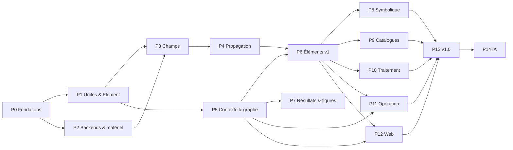

# LUMOS — Plan de développement

> Compagnon du [cahier des charges](cahier_des_charges.md). Statut : v0.1 (proposition), 2026-10-16.
>
> Chaque **étape** (`Px.y`) est dimensionnée pour une ou deux sessions de travail. Elle se termine par du code testé, documenté et commité. On ne démarre une étape que lorsque ses dépendances sont validées. Cocher les cases au fil de l'eau.

---

## Principes de conduite

1. **Fondations d'abord, verticalité ensuite.** Le cœur (paramètres, champs, propagation, contexte) est construit et validé physiquement avant d'élargir la bibliothèque d'éléments. Dès la phase 5, chaque phase livre une **tranche verticale** utilisable de bout en bout (notebook qui tourne).
2. **Validation physique systématique.** Chaque fonctionnalité physique arrive avec un test qui vérifie un résultat connu (analytique, littérature, ou référence HELIOS, PHISE, POPPY, HCIPy).
3. **Portage HELIOS et PHISE guidé par les tests.** Avant de porter un module, on écrit le test qui fige le comportement attendu (en le corrigeant si HELIOS était faux, cf. §2.2 du cahier des charges).
4. **Une décision structurante = un ADR** (`docs/adr/`), court : contexte, décision, alternatives, conséquences.
5. **Jalons de version** : v0.1 → v1.0, puis v1.x pour l'IA.

### Jalons

| Version | Contenu | Phases |
|---------|---------|--------|
| **v0.1** « Noyau » | Paramètres, backends, champs, propagation validée | 0 → 4 |
| **v0.2** « Simulateur » | Contexte et graphe, temps, éléments v1, résultats archivés, premiers notebooks | 5 → 7 |
| **v0.3** « Symbolique et ciel » | Symbolique, catalogues | 8 → 9 |
| **v0.4** « Traitement » | Pipelines de données, capacités de détection | 10 |
| **v0.5** « Opération » | Drivers, mode opération et jumeau | 11 |
| **v0.6** « Web » | Interface de programmation visuelle | 12 |
| **v1.0** | Stabilisation, docs complètes, préréglages et tutoriels | 13 |
| **v1.x** | Blocs IA | 14 |

> P7 peut démarrer en parallèle de P6 ; P12 (backend web) peut démarrer dès que P5 fournit le registre et les schémas.

---

## Phase 0 — Fondations du dépôt

**Objectif :** dépôt outillé, CI au vert, doc vide publiée.

- [ ] **P0.1 Décisions préalables** — trancher les questions ouvertes 1, 2, 3, 7 et 9 du cahier des charges. ADR-0001 « Stack et conventions ».
- [ ] **P0.2 Squelette** — `pyproject.toml` (src layout, extras définis dans NF-2, version dynamique), `src/lumos/__init__.py`, `LICENSE` (MIT), `CHANGELOG.md`, `.gitignore`, `README.md` (corriger `&amp;`).
- [ ] **P0.3 Qualité** — ruff (lint et format), mypy ou pyright, pytest + pytest-cov, pre-commit.
- [ ] **P0.4 CI** — GitHub Actions : lint, typage, tests (Windows et Linux × Python 3.12/3.13), construction de la doc.
- [ ] **P0.5 Docs** — Sphinx + Breeze + MyST + myst-nb + Mermaid, `.readthedocs.yaml`, pages squelettes (*Getting started*, *User guide*, *Learn*, *Examples*, *API*, *Contributing*, *ADR*), import de ce cahier des charges dans `docs/specs/`.
- [ ] **P0.6 Guide agent** — `CLAUDE.md` : conventions (unités, structure, tests physiques, ADR, docstrings NumPy en anglais, pas de fichiers à la racine, `tmp/` comme brouillon), plus le lien vers les specs.

**Critères d'acceptation :** `pip install -e .[dev]` fonctionne ; `pytest` passe (test fumée) ; la doc se construit sans avertissement sur RTD ; la CI est verte.

---

## Phase 1 — Unités, paramètres, Element, registre

**Objectif :** la brique de base de tout objet LUMOS.

- [ ] **P1.1 `lumos.units`** — helpers de validation (`require_unit(q, u.m)`), conversion SI, sérialisation `{"value", "unit"}` des quantités (scalaires et tableaux).
- [ ] **P1.2 `Param` (descripteur)** — unité, défaut, bornes, doc, `free`, `prior`, `differentiable`, mémorisation de l'unité utilisateur, stockage SI interne, callback d'invalidation (patron PHISE). Tests : erreurs d'unité, bornes, conversion aller-retour.
- [ ] **P1.3 `Port` et types de signaux (abstraits)** — direction, type, multiplicité, compatibilité.
- [ ] **P1.4 `Element`** — déclaration des paramètres et des ports, `describe()`, `_repr_html_`, `schema()` (JSON Schema), état virtuel, `__slots__` ou classe à attributs explicites (pas de `hasattr` dynamique).
- [ ] **P1.5 Registre** — identifiants stables `lumos.<famille>.<Classe>`, `type_version`, enregistrement par décorateur et par *entry points* (plugins).
- [ ] **P1.6 Sérialisation d'un élément** — `to_lumos()` / `from_lumos()` pour `kind: element`, validation du schéma, refus des types non enregistrés. ADR-0002 « Format .lumos ».

**Critères d'acceptation :** un élément jouet (`DummyLens(focal_length=…)`) se crée, se valide, se décrit, s'exporte et se réimporte à l'identique ; son schéma JSON contient les unités et les bornes.

---

## Phase 2 — Backends de calcul et détection du matériel

- [ ] **P2.1 `lumos.backend`** — sélection du namespace Array API (`numpy`, `jax.numpy`, `cupy`, `torch`), `xp = lumos.backend.get()`, conversion entre backends, contexte `with lumos.backend.use("jax"):`.
- [ ] **P2.2 FFT** — façade `fft2/ifft2/fftshift` par backend (scipy.fft avec `workers` sur CPU, `cupy.fft`, `jnp.fft`), politique de plans et de cache.
- [ ] **P2.3 Détection du matériel** — `lumos.hardware_report()` : OS, CPU, RAM, GPU et VRAM, CUDA, bibliothèques et versions. Sélection automatique du backend avec politique documentée. ADR-0003 « Politique de sélection du backend ».
- [ ] **P2.4 Précision et mémoire** — `config.precision`, estimateur mémoire, utilitaire de découpage (*chunking*).
- [ ] **P2.5 Compilation** — décorateurs `lumos.jit` (JAX `jit` si backend JAX, sinon passthrough) ; conventions numba pour les noyaux CPU. Premier benchmark.

**Critères d'acceptation :** la suite de tests passe sur NumPy, et sur JAX quand il est installé (paramétrisation pytest par backend) ; le rapport matériel est lisible et sérialisable en YAML.

---

## Phase 3 — Représentations du champ

- [ ] **P3.1 `Grid`** — rectangulaire, pas, centre, plan spatial ou angulaire, coordonnées (`x`, `y`, `meshgrid` paresseux), égalité et compatibilité, sérialisation. Tests des conventions de centrage (§8).
- [ ] **P3.2 `Wavefront`** — champ complexe, λ, normalisation, `intensity/phase/amplitude/power`, opérations (multiplication par un masque ou une phase, somme cohérente), copie, changement de backend.
- [ ] **P3.3 Polarisation** — Wavefront de Jones `(2, ny, nx)`, matrices de Jones (uniformes ou spatiales), conversion vers les Stokes.
- [ ] **P3.4 `Wavecube`** — axe spectral, poids spectraux, vectorisation, intégration spectrale, extraction d'une tranche.
- [ ] **P3.5 `IncoherentBundle`** — axe de modes incohérents, somme en intensité, construction à partir de sources ponctuelles (inclinaison de phase selon la position angulaire). Corrige le TODO HELIOS.
- [ ] **P3.6 `ModalField`** — amplitudes par mode ou par guide, × λ × modes incohérents ; application d'une S-matrice.
- [ ] **P3.7 `DataProduct`** — image, cube, série temporelle avec unités, axes, masque, incertitudes, métadonnées ; export FITS et NPZ.
- [ ] **P3.8 Tracés de base** — `wf.plot()`, `cube.plot()` avec axes physiques, phase en carte cyclique (prépare la P7).

**Critères d'acceptation :** tests de conservation (puissance invariante par changement de backend et par sérialisation) ; une source ponctuelle hors axe produit la rampe de phase attendue ; la S-matrice d'un coupleur 50/50 conserve l'énergie.

---

## Phase 4 — Propagation numérique

**Objectif :** O2. C'est le cœur scientifique ; il faut en soigner la validation.

- [ ] **P4.1 Suite de validation d'abord** — cas de référence : ouverture circulaire → Airy (champ lointain), ouverture carrée → sinc, faisceau gaussien en Fresnel (solution analytique de w(z) et R(z)), ouverture → champ proche comparé à `rs_direct`, conservation de Parseval. Tolérances explicites.
- [ ] **P4.2 Rayleigh-Sommerfeld direct** — référence (numba ou JAX, par blocs), grilles quelconques.
- [ ] **P4.3 Fraunhofer + MFT** — FFT (échantillonnage imposé) et MFT (échantillonnage et centre de sortie arbitraires) ; transformée pupille ↔ plan focal avec focale.
- [ ] **P4.4 Fresnel** — fonction de transfert (TF), réponse impulsionnelle (1 FFT), deux étapes avec changement d'échelle.
- [ ] **P4.5 ASM à bande limitée** — Matsushima ; puis ASM mis à l'échelle ou décalé (MFT ou CZT) pour des grilles de sortie quelconques.
- [ ] **P4.6 Planificateur** — critères d'échantillonnage, nombre de Fresnel, rembourrage, coût mémoire et temps estimé sur le matériel détecté, choix de méthode, journalisation et avertissements, forçage possible. ADR-0004 « Règles du planificateur ».
- [ ] **P4.7 Vectorisation** — λ, polarisation et modes incohérents en une passe, cache des noyaux, découpage mémoire.
- [ ] **P4.8 Différentiabilité** — tests de gradient (JAX) sur chaque méthode, par rapport à la phase d'entrée et à z.
- [ ] **P4.9 Comparaisons externes** — tests optionnels (extra `[validation]`) contre POPPY et HCIPy.
- [ ] **P4.10 Doc « Learn »** — reprise et mise à jour des pages HELIOS (`fraunhofer`, `fresnel`, `asm`, `scaled_asm`, `rs_direct`), page « Choisir l'échantillonnage », page « Planificateur ».
- [ ] **P4.11 Benchmarks** — CPU contre GPU, par méthode et par taille.

**Critères d'acceptation (fin de v0.1) :** toutes les méthodes passent la suite de validation dans leur domaine ; le planificateur choisit une méthode valide pour 100 % des cas de la suite ; l'écart à RS direct est < 1e-3 en énergie ; le gain GPU est mesuré et documenté.

---

## Phase 5 — Contexte, graphe, temps et modes

- [ ] **P5.1 `Graph`** — ajout et retrait d'éléments, connexions port → port avec vérification de type, détection de cycles, tri topologique, sous-graphe requis pour des sorties données.
- [ ] **P5.2 Exécution pull et cache** — cache par port, invalidation en aval sur changement de `Param` ou d'état (acquis HELIOS), exécution des fonctions de transfert pures.
- [ ] **P5.3 `Context`** — mode, backend, paramètres d'observation, graines, accès par nom, `ctx.run(outputs)`, opérateur `>>`.
- [ ] **P5.4 `ElementGroup`** — enfants, connexions internes, ports exposés, paramètres agrégés, imbrication, sérialisation `kind: group`.
- [ ] **P5.5 `Clock` et actions** — décorateur `@action(duration=…)` (fixe ou calculée), avance de l'horloge en simulation, `ctx.wait()`, `with ctx.parallel()`, éléments dépendants du temps.
- [ ] **P5.6 Modes** — simulation (journalisation des commandes, état virtuel) ; interface `Driver` et `SimulatedDriver` (la partie matérielle réelle vient en P11) ; dérogation par élément.
- [ ] **P5.7 Journal** — logging structuré (commandes, états, choix numériques, avertissements, durées), niveaux, export.
- [ ] **P5.8 `.lumos` contexte** — import et export complets, *sidecar* des tableaux, migrations (squelette), schéma JSON publié.
- [ ] **P5.9 Codegen** — génération d'un script Python équivalent à un contexte (aller-retour testé).
- [ ] **P5.10 Balayages** — `ctx.sweep(...)` (vectorisé ou par processus).

**Critères d'acceptation :** un contexte jouet (source → masque → propagation → détecteur fictif) s'exécute, se sauvegarde, se recharge et donne un résultat identique ; modifier un paramètre amont ne recalcule que l'aval ; une séquence d'actions simulées fait avancer l'horloge comme prévu.

---

## Phase 6 — Bibliothèque d'éléments v1 (portage HELIOS et PHISE)

Chaque élément arrive avec ses paramètres déclaratifs, ses ports, sa fonction de transfert numérique, un test physique, une docstring physique et une entrée dans la doc API.

- [ ] **P6.1 Sources** — source ponctuelle, laser gaussien, lampe incohérente, `Star` (corps noir, magnitudes, zéro-points via les profils de bandes), `Planet` (thermique et réfléchie, phase), exo-zodi et zodi, `PlanetarySystem` comme `ElementGroup` (géométrie orbitale de HELIOS).
- [ ] **P6.2 Ouvertures et pupilles** — constructeur par primitives (portage `Pupil`), préréglages JWST, VLT et ELT, anti-crénelage.
- [ ] **P6.3 Optique de volume** — espace libre (via le planificateur), lentille et miroir minces, séparatrice, lames et polariseurs (Jones), filtre spectral, ligne à retard.
- [ ] **P6.4 Télescopes et réseaux** — télescope, réseau de télescopes (VLTI, LIFE), projection des bases selon le pointage et l'angle horaire.
- [ ] **P6.5 Atmosphère et OA** — écrans von Kármán multi-couches à écoulement figé dépendant de `ctx.time`, chromatisme ; miroir déformable (Zernike, actionneurs) ; correction OA simple.
- [ ] **P6.6 Coronographes** — 4QPM, vortex (charge), Lyot ; validation par la profondeur de réjection théorique.
- [ ] **P6.7 Optique guidée** — modes LP (portage `lp_modes`), injection par recouvrement, fibre monomode et multimode.
- [ ] **P6.8 Photonique** — guide, déphaseur (TOPS), Y-splitter, coupleur, MMI (portage du solveur `sim/mmi.py`, découpé en physique / élément / visualisation), croisement ; puce comme `ElementGroup` ; préréglages kernel-nuller (architectures PHISE).
- [ ] **P6.9 Détecteurs** — caméra (QE(λ), bruits de photons, de lecture et d'obscurité, gain, saturation, binning, pose comme action temporisée), photodiode, puissance-mètre.
- [ ] **P6.10 Tests d'intégration de référence** — reproduire les démos HELIOS (comparaisons de propagation, PSF chromatique, coronographie, turbulence) et les résultats PHISE (sorties et carte de transmission du kernel-nuller, profondeur de nulling) dans les tolérances.

**Critères d'acceptation (cœur de v0.2) :** UC1 et UC7 réalisables en Python ; les tests d'intégration de référence passent.

---

## Phase 7 — Résultats, figures, archivage

- [ ] **P7.1 Style de figures** — feuille de style matplotlib LUMOS, cartes de couleurs (séquentielle, cyclique pour la phase, divergente), étiquettes avec unités automatiques depuis `Grid` et `DataProduct`.
- [ ] **P7.2 `lumos.plotting`** — tracés standard : intensité et phase, PSF (log), profil radial, spectre et SED, cartes de transmission, sorties de puce, graphe du contexte (successeur de `uml_export`).
- [ ] **P7.3 Export** — `save_figure(fig, name)` → `.png` + `.plt` (pltedit) + données sous-jacentes (`.npz`).
- [ ] **P7.4 Archive** — intégration `vfst.archive.new` : racine à côté du script ou du notebook, `context.lumos`, `metadata.yml` enrichi (rapport matériel, versions, mode, horloge, graines), `lumos.log`, `figures/`, `data/`.
- [ ] **P7.5 Relecture** — `lumos.load_archive(path)`.
- [ ] **P7.6 Premiers notebooks** — `examples/01_first_simulation.ipynb`, `02_propagation_methods.ipynb`, `03_psf_and_pupils.ipynb`, `04_interferometry.ipynb`, exécutés en CI et rendus dans la doc ; préréglages `.lumos` associés.

**Critères d'acceptation (fin de v0.2) :** un notebook produit une archive complète, et les `.plt` s'ouvrent dans PltEdit.

---

## Phase 8 — Symbolique

- [ ] **P8.1 `SymbolicField`** — variables canoniques, paramètres liés aux `Param`, domaine, plan ; rendu LaTeX.
- [ ] **P8.2 Symbols → grid** — `lambdify` par backend, cache, anti-crénelage des discontinuités, sortie Wavefront ou Wavecube selon la dépendance en λ.
- [ ] **P8.3 Transferts symboliques des éléments simples** — masques, phases (lentille, inclinaison, Zernike), Jones, S-matrices.
- [ ] **P8.4 Formes closes de propagation** — faisceaux gaussiens, HG et LG via ABCD ; transformées tabulées (circ, rect, gaussienne) pour Fraunhofer ; tentative SymPy avec délai, sinon **repli numérique journalisé**.
- [ ] **P8.5 Grid → symbols** — projections modales (Zernike, HG, LG, LP, Fourier), ajustement paramétrique (gaussien, Airy), régression parcimonieuse ; métrique d'erreur ; PySR en option.
- [ ] **P8.6 Intégration au graphe** — un port peut transporter un `SymbolicField` ; conversion automatique vers le numérique quand un élément aval n'a pas de transfert symbolique.
- [ ] **P8.7 Notebook** `05_symbolic_optics.ipynb`.

**Critères d'acceptation :** gaussien → lentille → espace libre en symbolique donne le résultat analytique, et son échantillonnage concorde avec la voie numérique à 1e-6 près ; la décomposition de Zernike d'un front d'onde aberré retrouve les coefficients injectés.

---

## Phase 9 — Catalogues astronomiques

- [ ] **P9.1 Infrastructure** — interface `Provider`, cache utilisateur (`platformdirs`, durée de vie), mode hors-ligne, TLS vérifié, timeouts par requête, `logging`.
- [ ] **P9.2 Enregistrements typés** — `StarRecord`, `ExoplanetRecord`, `SolarSystemRecord` avec unités, incertitudes et provenance.
- [ ] **P9.3 Portage des fournisseurs** — SIMBAD, VizieR, CALSPEC, ESO, IRSA/ISO, Pickles, NASA Exoplanet Archive, JPL Horizons, ASTM E490. Tests avec réponses enregistrées (pas de réseau en CI), plus des tests réseau marqués.
- [ ] **P9.4 Fusion de SED et complétion** — règles de priorité documentées, valeurs estimées signalées.
- [ ] **P9.5 Résolution** — `lumos.catalogs.resolve(name)` ; constructeurs `Star.from_catalog`, `Planet.from_catalog`, `PlanetarySystem.from_catalog`.
- [ ] **P9.6 Ajouts** — Gaia DR3, SVO Filter Profile Service, MAST, exoplanet.eu.
- [ ] **P9.7 Notebook** `06_targets_from_catalogs.ipynb`.

**Critères d'acceptation (fin de v0.3) :** `PlanetarySystem.from_catalog("TRAPPIST-1")` crée un groupe utilisable dans un contexte ; aucun appel réseau n'a lieu en CI hors tests marqués.

---

## Phase 10 — Pipelines de traitement et capacités de détection

- [ ] **P10.1 Blocs de réduction** — dark, champ plat, empilement, recadrage et rééchantillonnage, photométrie, profil radial, contraste, SNR.
- [ ] **P10.2 Blocs interférométriques** — profondeur de nulling, kernels, cartes de transmission (portage PHISE).
- [ ] **P10.3 Statistiques de détection** — statistiques de test, ROC, courbes de contraste limite, capacité de détection en fonction de la séparation et du contraste (portage PHISE).
- [ ] **P10.4 Calibration classique** — ajustement de phases de puce (PHISE essais-erreurs et génétique, HELIOS pour les MMI) comme blocs.
- [ ] **P10.5 Bloc « script »** — fonction utilisateur encapsulée.
- [ ] **P10.6 Notebooks** `07_data_pipeline.ipynb`, `08_detection_capability.ipynb`.

**Critères d'acceptation (fin de v0.4) :** UC6 réalisable ; les courbes ROC concordent avec PHISE sur un cas de référence.

---

## Phase 11 — Mode opération et pilotage matériel

- [ ] **P11.1 Interface `Driver` complète** — cycle de vie, erreurs, timeouts, reprise, arrêt d'urgence global, bornes, *dry-run*, confirmation des actions dangereuses, état sûr sur interruption.
- [ ] **P11.2 Découverte** — énumération USB, série, VISA et SDK ; association aux éléments.
- [ ] **P11.3 Premier driver réel** — l'équipement prioritaire du banc (question ouverte 4), par exemple une platine Kinesis ; tests sur matériel marqués `hardware` et exécutés manuellement.
- [ ] **P11.4 Drivers suivants** — caméra scientifique, puissance-mètre, contrôleur piézo, générique SCPI/VISA.
- [ ] **P11.5 Mode jumeau** — commandes appliquées au réel et au simulé, sorties côte à côte, résidus journalisés.
- [ ] **P11.6 Séquences** — enregistrement et rejeu d'une séquence d'actions en simulation puis en opération.
- [ ] **P11.7 Plugins de drivers** — *entry points* et documentation « Écrire un driver ».
- [ ] **P11.8 Notebook** `09_bench_operation.ipynb` (exécutable en simulation en CI).

**Critères d'acceptation (fin de v0.5) :** UC2 réalisé sur le vrai banc avec un même script qui bascule de mode par un seul paramètre ; l'arrêt d'urgence est testé.

---

## Phase 12 — Interface web

- [ ] **P12.1 Backend API** — FastAPI : registre et schémas des éléments, CRUD du contexte, exécution asynchrone, WebSocket (progression, logs), inspection de port, import et export `.lumos`, codegen, préréglages. Liaison `localhost` par défaut, opération désactivée hors local.
- [ ] **P12.2 Frontend : socle** — Vite, React, `@xyflow/react`, Tailwind ; palette générée depuis le registre ; nœuds génériques rendus depuis les schémas (aucun code par composant).
- [ ] **P12.3 Édition** — ajout, suppression, déplacement, connexion typée, formulaires avec unités, annulation et rétablissement.
- [ ] **P12.4 Groupes** — création par sélection, repli et dépli, sauvegarde comme bloc.
- [ ] **P12.5 Exécution et inspection** — lancement, progression, visualisations de port (intensité, phase, spectres, données), téléchargements.
- [ ] **P12.6 Préréglages et tutoriel** — chargement des `.lumos` d'exemple, visite guidée pas à pas.
- [ ] **P12.7 Opération depuis le web** — panneau des équipements, état, actions et arrêt d'urgence (local uniquement).
- [ ] **P12.8 Déploiement** — Docker multi-étapes (acquis HELIOS), instance de démo optionnelle (simulation seulement, quotas).
- [ ] **P12.9 Tests** — tests API (pytest), tests de bout en bout du frontend (Playwright).

**Critères d'acceptation (fin de v0.6) :** UC4 réalisé ; un contexte créé dans le web s'exporte en `.lumos` et en script qui donnent le même résultat en Python (O4).

---

## Phase 13 — Stabilisation v1.0

- [ ] **P13.1 Revue d'API publique** — nommage, cohérence, dépréciations ; gel de l'API et du format `.lumos` 1.x.
- [ ] **P13.2 Docs complètes** — user guide, learn, hardware, web, ADR ; tous les notebooks rendus ; tutoriels.
- [ ] **P13.3 Performance** — profilage des cas de référence, optimisation ciblée (extension native seulement si justifiée, ADR à l'appui).
- [ ] **P13.4 Qualité** — couverture, typage strict du cœur, audit de sécurité (chargement `.lumos`, web, réseau).
- [ ] **P13.5 Publication** — PyPI (*trusted publishing*), annonce, archivage éventuel de HELIOS (question ouverte 8).

---

## Phase 14 — Blocs IA (v1.x)

- [ ] **P14.1 Générateur de jeux de données** — échantillonnage des paramètres libres selon leurs a priori, export standardisé.
- [ ] **P14.2 Calibration par gradient** — ajustement des paramètres libres sur des données réelles (mode jumeau) via la simulation différentiable JAX (optax).
- [ ] **P14.3 Inférence bayésienne** — NumPyro ou BlackJAX (HMC) sur un `ElementGroup` a priori ; SBI (`sbi`) quand la vraisemblance est intraitable.
- [ ] **P14.4 Reconstruction de scène** — UC8 : compagnons (nombre, positions, flux) à partir des sorties réelles.
- [ ] **P14.5 Blocs appris** — débruitage, détection, *surrogates* de sous-graphes coûteux.
- [ ] **P14.6 Notebooks et préréglages IA.**

---

## Correspondance HELIOS / PHISE → LUMOS (aide au portage)

| Source | Destination | Étape |
|--------|-------------|-------|
| `helios/core/layer.py`, `pipeline.py` (pull + cache) | `lumos/core/graph.py`, `context.py` | P5.1–P5.3 |
| `helios/core/wavefront.py`, `optical_scene.py` | `lumos/fields/*` | P3 |
| `helios/sim/propagation.py` | `lumos/propagation/*` | P4 |
| `helios/components/generation/scene.py`, `sim/spectrum.py` | `lumos/elements/sources/*`, `lumos/physics/sed.py` | P6.1 |
| `helios/components/sampling/*` | `lumos/elements/apertures/*` | P6.2, P6.4 |
| `helios/components/generation/atmosphere.py`, `bulk_optics/adaptive_optics.py` | `lumos/elements/environment/*`, `optics/dm.py` | P6.5 |
| `helios/components/bulk_optics/coronagraph.py` | `lumos/elements/optics/coronagraph.py` | P6.6 |
| `helios/sim/lp_modes.py`, `components/photonics/fibers.py` | `lumos/physics/lp_modes.py`, `elements/guided/*` | P6.7 |
| `helios/sim/mmi.py`, `components/photonics/*` | `lumos/physics/mmi/*`, `elements/photonics/*` | P6.8 |
| `phise/classes/archs/*`, `subcomponents/*` | préréglages `elements/photonics/presets/*` | P6.8 |
| `helios/components/detection/camera.py`, `phise/classes/camera.py` | `lumos/elements/detectors/*` | P6.9 |
| `helios/io/uml_export.py` | `lumos/plotting/graph.py` | P7.2 |
| `helios/io/external_query/**`, `utils/data_completion/*` | `lumos/catalogs/**` | P9 |
| `phise/modules/{roc,test_statistics,detection_capability,transmission_map,signals}.py` | `lumos/elements/processing/*` | P10.2–P10.3 |
| `phise/modules/calibration/*`, `helios/sim/mmi.py` (calibration) | `lumos/elements/processing/calibration/*` | P10.4 |
| `phise/modules/ml.py` | `lumos/ai/*` | P14 |
| `HELIOS/web/**` | `LUMOS/web/**` + `lumos/web/*` (refonte pilotée par schéma) | P12 |
| `HELIOS/demo/**` | `examples/*.ipynb` + `examples/presets/*.lumos` | P7.6, P13.2 |
| `HELIOS/docs/learn/**` | `docs/learn/**` | P4.10, P6 |

---

## Risques et parades

| Risque | Impact | Parade |
|--------|--------|--------|
| L'abstraction multi-backend ralentit le développement | Élevé | NumPy de référence d'abord, JAX en second ; CuPy et Torch seulement via Array API sans code spécifique ; tests paramétrés par backend |
| Planificateur de propagation trop ambitieux | Élevé | Suite de validation écrite **avant** (P4.1) ; règles simples et documentées, affinées ensuite |
| Symbolique : explosion des expressions | Moyen | Délais, simplification ciblée, repli numérique systématique (REQ-SYM-5) |
| Drivers propriétaires (Kinesis .NET, Windows only) | Moyen | Interface `Driver` stricte, `pylablib` en priorité, tests matériels manuels |
| Périmètre très large | Élevé | Jalons verticaux, priorités M/S/C, P14 explicitement repoussée |
| Dette de portage (bugs HELIOS reproduits) | Moyen | Portage guidé par les tests physiques, pas par copier-coller |
| Pureté des transferts incompatible avec l'état des équipements | Moyen | Séparer l'état (actions, driver) du calcul (transfert pur qui reçoit l'état en argument), à fixer dans un ADR en P1.4 et P5.5 |

---

## Prochaine étape proposée

Valider ou amender le cahier des charges, répondre aux **questions ouvertes** (§11 du cahier des charges), puis lancer **P0.1 → P0.6**.
