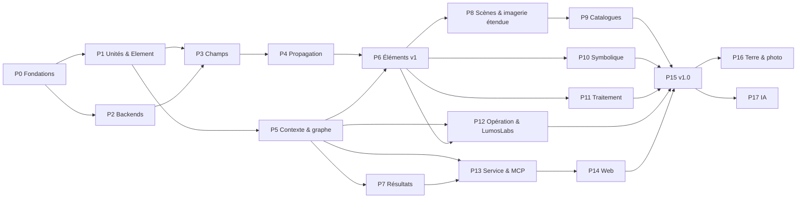

# LUMOS — Plan de développement

> Compagnon du [cahier des charges](cahier_des_charges.md). Statut : v0.2, 2026-10-16.
>
> Chaque **étape** (`Px.y`) est dimensionnée pour une ou deux sessions de travail. Elle se termine par du code testé, documenté et commité. On ne démarre une étape que lorsque ses dépendances sont validées. Cocher les cases au fil de l'eau.

---

## Principes de conduite

1. **Cycle de chaque étape : spécifier → tester → implémenter → documenter.**
   1. *Spécifier* : relire les exigences visées et préciser le comportement attendu.
   2. *Tester* : écrire les tests à partir de la spécification, avec des valeurs attendues issues de sources indépendantes (cahier des charges §7.2), puis les commiter seuls (`test(Px.y): …`). Ils doivent échouer.
   3. *Implémenter* jusqu'au vert **sans toucher aux tests** (`feat(Px.y): …`).
   4. *Documenter* : docstrings, pages de doc, `CHANGELOG`, ADR si une décision a été prise.
   5. Un test erroné ou dont l'objectif change est corrigé dans un commit dédié `test(Px.y)!: …` qui donne la justification (cahier des charges §7.1).
2. **Fondations d'abord, verticalité ensuite.** Le cœur est validé physiquement avant d'élargir la bibliothèque ; dès la phase 5, chaque phase livre une tranche utilisable de bout en bout (notebook qui tourne).
3. **Une décision structurante = un ADR** (`docs/adr/`).
4. **Commits au format *Conventional Commits*** qui référencent l'étape.
5. **Anglais** pour le code, les docstrings, les notebooks et les identifiants ; la doc et le web sont traduits en français.

### Jalons

| Version | Contenu | Phases |
|---------|---------|--------|
| **v0.1** « Noyau » | Paramètres, backends, champs, propagation validée | 0 → 4 |
| **v0.2** « Simulateur » | Contexte et graphe, temps, éléments v1, résultats archivés | 5 → 7 |
| **v0.3** « Scènes » | Scènes diffuses et imagerie étendue, catalogues | 8 → 9 |
| **v0.4** « Symbolique et traitement » | Symbolique, pipelines de données | 10 → 11 |
| **v0.5** « Opération » | Drivers, LumosLabs, jumeau numérique | 12 |
| **v0.6** « Assistant » | Couche de service et serveur MCP | 13 |
| **v0.7** « Web » | Interface web bilingue, instance publique et authentification | 14 |
| **v1.0** | Stabilisation, docs EN/FR complètes, préréglages et tutoriels | 15 |
| **v1.x** | Observation de la Terre et photographie ; blocs IA | 16 → 17 |

> P7 peut avancer en parallèle de P6. Une première version de P13 (MCP en lecture : découverte, construction, exécution) peut être livrée dès la fin de P7, pour profiter de l'assistant pendant le reste du développement.

---

## Phase 0 — Fondations du dépôt

- [x] **P0.1 Conventions** — `CLAUDE.md` : cycle de chaque étape, règles de test (cahier des charges §7), unités, structure, langue, *Conventional Commits*, interdits (fichiers à la racine, `print`, `pickle`, désactivation TLS). ADR-0001 « Stack et conventions ».
- [x] **P0.2 Squelette** — `pyproject.toml` (nom `lumos-maxima`, import `lumos`, src layout, extras définis dans NF-2, version dynamique, bornes Python selon SPEC 0), `src/lumos/__init__.py`, `LICENSE` MIT, `CHANGELOG.md`, `.gitignore`, `README.md` (corriger `&amp;`).
- [x] **P0.3 Qualité** — ruff, pyright ou mypy, pytest, pytest-cov, hypothesis, pre-commit.
- [x] **P0.4 CI** — lint, typage, tests (matrice OS × versions Python), doc ; job d'**intégrité des tests** (alerte sur les commits qui modifient `tests/` et `src/` ensemble, ou un test sans `test(…)!`).
- [x] **P0.5 Docs** — Sphinx + Breeze + MyST + myst-nb + Mermaid, `.readthedocs.yaml`, squelette des sections (REQ-DOC-4), chaîne de traduction `sphinx-intl` (EN → FR) et projet RTD FR.
- [x] **P0.6 Réservation du nom** — publication d'une version `0.0.1` vide de `lumos-maxima` sur TestPyPI puis PyPI (*trusted publishing*).
  - *Fait le 2026-10-16 :* `lumos-maxima` 0.0.1 publié sur PyPI par *trusted publishing* (tag `v0.0.1`).

**Critères d'acceptation :** `pip install -e .[dev]` fonctionne ; un test fumée passe ; la doc EN et FR se construit sans avertissement ; la CI est verte ; le job d'intégrité détecte un commit mixte de test.

---

## Phase 1 — Unités, paramètres, Element, registre

- [x] **P1.1 `lumos.units`** — validation (`require_unit`), conversion SI, sérialisation `{"value", "unit"}` des scalaires et des tableaux.
- [x] **P1.2 `Param`** — descripteur : unité, défaut, bornes, doc, `free`, `prior`, `differentiable`, unité utilisateur mémorisée, stockage SI, callback d'invalidation.
- [x] **P1.3 `Port` et types de signaux abstraits** — direction, type, multiplicité, règles de compatibilité.
- [x] **P1.4 `Element`** — paramètres et ports déclaratifs, état virtuel séparé du transfert pur (ADR-0002 « État et transferts purs »), `describe()`, `_repr_html_`, `schema()`.
- [x] **P1.5 Registre** — identifiants stables, `type_version`, décorateur d'enregistrement, *entry points*.
- [x] **P1.6 Sérialisation d'un élément** — `kind: element`, validation par schéma, refus des types non enregistrés. ADR-0003 « Format .lumos ».

**Tests écrits d'abord :** erreurs et conversions d'unités, bornes, aller-retour de sérialisation (Hypothesis), contenu du schéma JSON, refus d'un type inconnu, invalidation déclenchée par un changement de `Param`.

---

## Phase 2 — Backends de calcul et détection du matériel

- [x] **P2.1 `lumos.backend`** — namespace Array API, `with lumos.backend.use("jax"):`, conversions.
- [x] **P2.2 FFT** — façade par backend, *workers* CPU, cache de plans.
- [x] **P2.3 Détection du matériel** — `lumos.hardware_report()`, sélection automatique. ADR-0004 « Politique de sélection du backend ».
- [x] **P2.4 Précision et mémoire** — `config.precision`, estimateur mémoire, découpage.
- [x] **P2.5 Compilation** — `lumos.jit` (JAX) et conventions numba ; premier *benchmark*.

**Tests écrits d'abord :** équivalence numérique NumPy/JAX sur les primitives (comparée à `numpy.fft` comme référence indépendante), sérialisation du rapport matériel, respect des forçages utilisateur, découpage qui donne le même résultat qu'un calcul monobloc.

---

## Phase 3 — Représentations du champ

- [x] **P3.1 `Grid`** — rectangulaire, centre, plan spatial ou angulaire, coordonnées paresseuses.
- [x] **P3.2 `Wavefront`** — champ complexe, λ, normalisation, propriétés, opérations.
- [x] **P3.3 Polarisation** — Jones, matrices de Jones, Stokes.
- [x] **P3.4 `Wavecube`** — axe spectral, poids, intégration.
- [x] **P3.5 `IncoherentBundle`** — axe de modes, somme en intensité, rampes de phase pour les sources hors axe.
- [x] **P3.6 `RadianceField`** — radiance spectrale sur grille, unités radiométriques, rééchantillonnage conservatif.
- [x] **P3.7 `ModalField`** — amplitudes modales, application de S-matrices.
- [x] **P3.8 `DataProduct`** — axes, unités, masque, incertitudes ; FITS et NPZ.
- [x] **P3.9 Tracés de base** — axes physiques, phase en carte cyclique.

**Tests écrits d'abord :** conventions de centrage (§9 du cahier des charges), invariance de la puissance au changement de backend et à la sérialisation, inclinaison de phase d'une source hors axe (forme analytique), loi de Malus avec un polariseur, unitarité d'un coupleur 50/50, conservation du flux au rééchantillonnage d'une `RadianceField`, aller-retour FITS.

---

## Phase 4 — Propagation numérique

- [x] **P4.1 Suite de validation** (écrite en premier, et elle constitue l'étape à elle seule) — Airy (zéros à 1,22 ; 2,23 ; 3,24 λ/D), sinc d'une ouverture carrée, faisceau gaussien en Fresnel (w(z), R(z), phase de Gouy), champ proche d'une ouverture comparé à l'intégrale de RS calculée indépendamment sur un petit cas, Parseval, réciprocité, rétro-propagation, tolérances justifiées physiquement.
- [x] **P4.2 Rayleigh-Sommerfeld direct** — référence par blocs, grilles quelconques.
- [x] **P4.3 Fraunhofer + MFT** — échantillonnage et centre de sortie arbitraires ; pupille ↔ plan focal.
- [x] **P4.4 Fresnel** — fonction de transfert, réponse impulsionnelle, deux étapes.
- [x] **P4.5 ASM à bande limitée**, puis ASM mis à l'échelle ou décalé (MFT ou CZT).
- [x] **P4.6 Planificateur** — critères d'échantillonnage, coût estimé, choix de méthode, journalisation et forçage. ADR-0005 « Règles du planificateur ».
- [x] **P4.7 Vectorisation** — λ, polarisation, modes ; cache des noyaux ; découpage.
- [x] **P4.8 Différentiabilité** — gradients JAX vérifiés par différences finies.
- [ ] **P4.9 Comparaisons externes** — POPPY et HCIPy (extra `[validation]`).
- [ ] **P4.10 Doc *Learn*** — méthodes, échantillonnage, planificateur.
- [ ] **P4.11 Benchmarks** CPU contre GPU.

**Critères d'acceptation (v0.1) :** toutes les méthodes passent la suite dans leur domaine de validité ; le planificateur choisit une méthode valide sur 100 % des cas ; l'écart à RS direct est < 1e-3 en énergie ; le gain GPU est mesuré et documenté.

---

## Phase 5 — Contexte, graphe, temps et modes

- [ ] **P5.1 `Graph`** — connexions typées, détection de cycles, tri topologique, sous-graphe requis.
- [ ] **P5.2 Exécution pull et cache** — cache par port, invalidation en aval.
- [ ] **P5.3 `Context`** — mode, jumeau, backend, observation, graines, accès par nom, `>>`.
- [ ] **P5.4 `ElementGroup`** — ports exposés, imbrication, sérialisation `kind: group`.
- [ ] **P5.5 `Clock` et actions** — `@action(duration=…)`, `ctx.wait`, `ctx.parallel`, éléments dépendants du temps.
- [ ] **P5.6 Modes** — simulation, interface `Driver`, `SimulatedDriver`, dérogation par élément, squelette du jumeau.
- [ ] **P5.7 Journal** — logging structuré avec l'origine des actions.
- [ ] **P5.8 `.lumos` contexte** — import et export, *sidecar*, migrations, JSON Schema publié.
- [ ] **P5.9 Codegen** — script Python équivalent.
- [ ] **P5.10 Balayages** — `ctx.sweep`.

**Tests écrits d'abord :** refus d'une connexion incompatible ou d'un cycle ; seul l'aval est recalculé après un changement de paramètre (compteurs d'appels) ; avance de l'horloge pour des actions séquentielles et parallèles (valeurs calculées à la main) ; aller-retour `.lumos` et codegen à résultat identique ; une commande simulée est journalisée sans appel au transport.

---

## Phase 6 — Bibliothèque d'éléments v1

Chaque élément arrive avec ses paramètres déclaratifs, ses ports, son transfert numérique, ses **tests physiques écrits avant**, sa docstring physique et sa doc API.

- [ ] **P6.1 Sources ponctuelles et de laboratoire** — source ponctuelle, `Star` (corps noir, magnitudes, bandes), `Planet` (thermique et réfléchie, phase), système planétaire (géométrie orbitale), laser gaussien, lampe incohérente.
- [ ] **P6.2 Ouvertures et pupilles** — primitives, préréglages JWST, VLT et ELT, anti-crénelage.
- [ ] **P6.3 Optique de volume** — espace libre, lentille et miroir minces, séparatrice, lames, polariseurs, filtre, ligne à retard.
- [ ] **P6.4 Télescopes et réseaux** — préréglages VLTI et LIFE, bases projetées.
- [ ] **P6.5 Atmosphère et OA** — von Kármán multi-couches dépendant du temps, miroir déformable, correction simple.
- [ ] **P6.6 Coronographes** — 4QPM, vortex, Lyot.
- [ ] **P6.7 Optique guidée** — modes LP, injection, fibres.
- [ ] **P6.8 Photonique** — guide, déphaseur, Y-splitter, coupleur, MMI (solveur de modes), croisement ; puce comme groupe ; préréglages Bracewell et nulleur à noyaux.
- [ ] **P6.9 Détecteurs** — caméra (bruits, pose temporisée), photodiode, puissance-mètre.
- [ ] **P6.10 Tests d'intégration de référence** — PSF chromatique, coronographie idéale, turbulence (fonction de structure de Kolmogorov), réponse d'un nulleur à noyaux comparée à la littérature (Martinache & Ireland 2018), carte de transmission d'un Bracewell (analytique).

**Critères d'acceptation :** UC1 et UC8 réalisables en Python ; tests d'intégration au vert.

---

## Phase 7 — Résultats, figures, archivage

- [ ] **P7.1 Style de figures** — feuille de style, cartes de couleurs, étiquettes avec unités automatiques.
- [ ] **P7.2 `lumos.plotting`** — intensité et phase, PSF, profil radial, spectres, cartes de transmission, sorties de puce, graphe du contexte.
- [ ] **P7.3 Export** — `.png` + `.plt` (pltedit) + données `.npz`.
- [ ] **P7.4 Archive** — `vfst.archive.new` à côté du script ou du notebook ; `context.lumos`, `metadata.yml` enrichi, `lumos.log`, `figures/`, `data/`.
- [ ] **P7.5 Relecture** — `lumos.load_archive`.
- [ ] **P7.6 Premiers notebooks** — `01_first_simulation`, `02_propagation_methods`, `03_psf_and_pupils`, `04_interferometry` ; exécutés en CI ; préréglages `.lumos`.

**Critères d'acceptation (v0.2) :** un notebook produit une archive complète ; les `.plt` se rechargent avec `pltedit.load` ; les métadonnées contiennent tous les champs de REQ-RES-2.

---

## Phase 8 — Scènes et imagerie de scènes étendues

- [ ] **P8.1 `Scene` et repères** — céleste, terrestre, laboratoire ; placement à l'infini ou à distance finie.
- [ ] **P8.2 Radiométrie** — radiance, éclairement, flux en pupille, étendue, photons ↔ énergie, magnitudes et bandes.
- [ ] **P8.3 Composants diffus paramétriques** — disque, gaussienne, Sérsic, anneau ou disque incliné, zodi, fond.
- [ ] **P8.4 Composants cartographiés** — import FITS avec WCS, cubes, images calibrées ; rééchantillonnage conservatif.
- [ ] **P8.5 Stratégies d'imagerie** — isoplanatique (convolution), anisoplanatique (grille de PSF), décomposition en `IncoherentBundle` ; sélection automatique et journalisée. ADR-0006 « Imagerie des scènes étendues ».
- [ ] **P8.6 Composants procéduraux** — textures et champs aléatoires (tests, imagerie générique).
- [ ] **P8.7 Notebook** `05_extended_scenes` (disque de débris derrière un coronographe, nébuleuse).

**Tests écrits d'abord :** flux total d'un corps noir intégré (loi de Stefan-Boltzmann), conservation du flux scène → image, équivalence des trois stratégies sur un système isoplanatique, image d'un disque uniforme par une ouverture circulaire comparée à la solution analytique, refus de la stratégie convolutive pour un système non invariant.

---

## Phase 9 — Catalogues astronomiques

- [ ] **P9.1 Infrastructure** — `Provider`, cache utilisateur, mode hors-ligne, TLS vérifié, timeouts par requête.
- [ ] **P9.2 Enregistrements typés** avec provenance par champ.
- [ ] **P9.3 Fournisseurs stellaires et exoplanétaires** — SIMBAD, VizieR, Gaia DR3, CALSPEC, ESO, IRSA, MAST, NASA Exoplanet Archive, exoplanet.eu.
- [ ] **P9.4 Système solaire** — JPL Horizons, spectre solaire de référence.
- [ ] **P9.5 Bandes et modèles** — SVO Filter Profile Service, bibliothèques de spectres modèles.
- [ ] **P9.6 Objets diffus** — images et cubes (SkyView, hips2fits, archives) → composants cartographiés.
- [ ] **P9.7 Fusion de SED et complétion.**
- [ ] **P9.8 Résolution et constructeurs** — `resolve`, `Star.from_catalog`, `Scene.from_catalog`, `MappedComponent.from_survey`.
- [ ] **P9.9 Notebook** `06_targets_from_catalogs`.

**Tests écrits d'abord :** sur des réponses enregistrées (aucun réseau en CI) ; valeurs attendues relevées manuellement dans les catalogues et citées ; vérification que TLS n'est jamais désactivé ; comportement hors-ligne.

**Critères d'acceptation (v0.3) :** `Scene.from_catalog("TRAPPIST-1")` et `MappedComponent.from_survey("M42", …)` sont utilisables dans un contexte.

---

## Phase 10 — Symbolique

- [ ] **P10.1 `SymbolicField`**, rendu LaTeX.
- [ ] **P10.2 Symbols → grid** — `lambdify` par backend, anti-crénelage.
- [ ] **P10.3 Transferts symboliques** des éléments simples.
- [ ] **P10.4 Formes closes** — gaussiens, HG et LG via ABCD ; transformées tabulées ; repli numérique journalisé.
- [ ] **P10.5 Grid → symbols** — projections modales, ajustements, régression parcimonieuse, PySR en option.
- [ ] **P10.6 Intégration au graphe** — conversion automatique symbolique → numérique.
- [ ] **P10.7 Notebook** `07_symbolic_optics`.

**Tests écrits d'abord :** gaussien → lentille → espace libre comparé à la solution ABCD analytique ; évaluation symbolique et numérique concordantes à 1e-6 ; coefficients de Zernike injectés retrouvés ; repli déclenché et journalisé quand il n'y a pas de forme close.

---

## Phase 11 — Pipelines de traitement et capacités de détection

- [ ] **P11.1 Réduction** — dark, champ plat, empilement, rééchantillonnage, photométrie, profil radial, contraste, SNR.
- [ ] **P11.2 Interférométrie** — profondeur de nulling, observables à noyaux, cartes de transmission.
- [ ] **P11.3 Statistiques de détection** — tests statistiques, ROC, contraste limite, capacité de détection.
- [ ] **P11.4 Calibration classique** — ajustement de phases, mesure de MTF (lame inclinée), mesure de PSF.
- [ ] **P11.5 Bloc « script ».**
- [ ] **P11.6 Notebooks** `08_data_pipeline`, `09_detection_capability`.

**Tests écrits d'abord :** ROC d'un test de Neyman-Pearson sur un signal gaussien comparée à la forme analytique ; MTF d'une optique limitée par la diffraction comparée à la formule analytique ; propagation correcte des incertitudes.

**Critères d'acceptation (v0.4) :** UC7 réalisable.

---

## Phase 12 — Mode opération, LumosLabs et jumeau numérique

- [ ] **P12.1 Interface `Driver` complète** — cycle de vie, erreurs, timeouts, reprise, arrêt d'urgence, bornes, *dry-run*, confirmations, état sûr sur interruption.
- [ ] **P12.2 Transports** — série (y compris virtuelle), TCP, VISA ; abstraction testable.
- [ ] **P12.3 Protocole LumosLabs** — spécification ASCII documentée (commandes, réponses, erreurs), commune à toute la gamme.
- [ ] **P12.4 Émulateurs LumosLabs** — `LL-LS100`, `LL-RS360`, `LL-PZ3`, `LL-SH1`, `LL-FW6`, `LL-LD`, `LL-PM`, `LL-CAM`, `LL-PCU` (cahier des charges §5.8.1), avec latences, bruit, limites et injection de fautes ; lancés par `lumos emulators start`.
- [ ] **P12.5 Drivers LumosLabs** — un driver par équipement, sur le transport réel.
- [ ] **P12.6 Découverte** — énumération et association aux éléments.
- [ ] **P12.7 Jumeau numérique** — commandes appliquées au réel et au simulé, sorties côte à côte, résidus ; `LL-CAM` et `LL-PM` reçoivent leurs mesures du jumeau avec un bruit et des défauts propres à l'émulateur, ce qui crée un écart réel/simulé contrôlé.
- [ ] **P12.8 Séquences** — enregistrement et rejeu.
- [ ] **P12.9 Plugins de drivers** — *entry points*, guide « Writing a driver » ; vérification que l'interface couvre les SDK Thorlabs (Kinesis, TSI, TLPM), en vue du premier driver constructeur.
- [ ] **P12.10 Notebook** `10_bench_operation` (exécuté en CI contre les émulateurs).

**Tests écrits d'abord :** respect des bornes même sur une commande directe ; l'arrêt d'urgence interrompt un mouvement en cours ; reprise après une déconnexion injectée ; un même script donne un journal de commandes identique en simulation et en opération ; la durée réelle mesurée est cohérente avec la durée prédite.

**Critères d'acceptation (v0.5) :** UC3 et UC4 réalisés de bout en bout avec les émulateurs LumosLabs.

---

## Phase 13 — Couche de service et serveur MCP

- [ ] **P13.1 `lumos.service`** — sessions, contextes, édition, exécution asynchrone avec progression, inspection, catalogues, archives, opération ; API typée (Pydantic). ADR-0007 « Couche de service ».
- [ ] **P13.2 Serveur MCP (stdio)** — outils de découverte, construction, vérification, exécution et résultats (REQ-MCP-2) ; commande `lumos mcp`.
- [ ] **P13.3 Ressources et prompts** — docs, schémas, préréglages, contexte courant, journaux ; prompts par cas d'usage.
- [ ] **P13.4 Outils d'opération** — désactivés par défaut ; confirmation humaine par *elicitation* ; bornes côté serveur ; traçabilité de l'origine MCP.
- [ ] **P13.5 Réponses adaptées aux LLM** — résumés, unités, erreurs exploitables, figures renvoyées en image.
- [ ] **P13.6 Transport HTTP *streamable*** — prêt à être adossé à l'instance web (authentification en P14).
- [ ] **P13.7 Doc « AI assistant »** — configuration pas à pas de Claude Code et Claude Desktop, exemples de conversations ; test de conformité générique au protocole MCP pour les autres clients.
- [ ] **P13.8 Évaluation** — scénarios types (UC1, UC8, UC9) avec résultat attendu vérifiable.

**Tests écrits d'abord :** chaque outil est appelé via un client MCP de test ; parité entre service, MCP et API Python (même `.lumos` et même résultat) ; refus d'une action matérielle sans confirmation ; refus en mode désactivé.

**Critères d'acceptation (v0.6) :** depuis Claude Code, un utilisateur construit, exécute et analyse le préréglage coronographe en langage naturel.

---

## Phase 14 — Interface web

- [ ] **P14.1 Backend HTTP** — adaptateur FastAPI de la couche de service, WebSocket, liaison `localhost` par défaut.
- [ ] **P14.2 Authentification et autorisation** — mot de passe (Argon2id), clé SSH (défi signé via `ssh-keygen -Y sign` ou `lumos login`), sessions expirantes, rôles, limitation de débit, journal d'audit, TLS obligatoire dès que l'opération est activée hors local. ADR-0008 « Modèle de sécurité de l'instance publique ».
- [ ] **P14.3 Configuration de déploiement** — profils `local` et `public` ; opération interdite par défaut en `public` ; quotas de calcul.
- [ ] **P14.4 Frontend : socle** — Vite, React, `@xyflow/react`, Tailwind, i18next (EN/FR) ; palette et nœuds générés depuis les schémas.
- [ ] **P14.5 Édition** — blocs, connexions typées, formulaires avec unités, annulation et rétablissement, groupes.
- [ ] **P14.6 Exécution et inspection** — progression, visualisations de port, téléchargements.
- [ ] **P14.7 Préréglages et tutoriel** pas à pas.
- [ ] **P14.8 Panneau opération** — équipements, état, actions, arrêt d'urgence (selon les droits).
- [ ] **P14.9 Panneau assistant** (optionnel) connecté au MCP HTTP.
- [ ] **P14.10 Déploiement** — Docker (machine unique, profil `local` utilisé jusqu'à la v1.0) ; documentation d'hébergement de l'instance publique sur un VPS (reverse proxy, TLS, quotas adaptés à la machine).
- [ ] **P14.11 Tests** — API, sécurité (accès refusé sans authentification, élévation de rôle, rejeu de défi SSH), parcours de bout en bout (Playwright) en EN et FR.

**Critères d'acceptation (v0.7) :** UC5 réalisé sur l'instance publique ; opération impossible sur l'instance publique sans configuration et authentification ; parité web, Python et MCP vérifiée.

---

## Phase 15 — Stabilisation v1.0

- [ ] **P15.1 Revue d'API** — nommage et cohérence ; gel de l'API et du format `.lumos` 1.x.
- [ ] **P15.2 Docs complètes EN et FR** — user guide, learn, hardware, web, assistant, ADR ; notebooks ; tutoriels.
- [ ] **P15.3 Performance** — profilage, optimisation ciblée (extension native seulement si justifiée).
- [ ] **P15.4 Qualité et sécurité** — couverture, typage strict, audit (chargement `.lumos`, web, MCP, réseau).
- [ ] **P15.5 Publication** — `lumos-maxima` 1.0 sur PyPI ; mise en ligne de l'instance publique sur le VPS (profil `public`, opération désactivée).

---

## Phase 16 — Observation de la Terre et photographie (v1.x)

- [ ] **P16.1 Plateforme orbitale** — TLE/SGP4 ou éléments képlériens, attitude, pointage, trace au sol.
- [ ] **P16.2 Scènes terrestres** — cartes de radiance géoréférencées (GeoTIFF), repère WGS84, illumination solaire.
- [ ] **P16.3 Modes de détection** — matriciel, *pushbroom*, TDI ; flou de bougé.
- [ ] **P16.4 Atmosphère simple** et plugins de transfert radiatif.
- [ ] **P16.5 Métriques** — MTF, GSD, SNR ; notebook `11_earth_observation`.
- [ ] **P16.6 Photographie** — scène image + profondeur, objectif épais, mise au point, filtre de Bayer et dématriçage ; notebook `12_camera`.

---

## Phase 17 — Blocs IA (v1.x)

- [ ] **P17.1 Générateur de jeux de données** à partir des paramètres libres et de leurs a priori.
- [ ] **P17.2 Calibration par gradient** sur le jumeau numérique (JAX, optax).
- [ ] **P17.3 Inférence bayésienne** (NumPyro, BlackJAX) et SBI (`sbi`).
- [ ] **P17.4 Reconstruction de scène**, ponctuelle et diffuse.
- [ ] **P17.5 Blocs appris** — débruitage, détection, *surrogates*.
- [ ] **P17.6 Outils MCP associés** (lancer une calibration, interpréter une reconstruction) et notebooks.

---

## Risques et parades

| Risque | Impact | Parade |
|--------|--------|--------|
| Abstraction multi-backend coûteuse | Élevé | NumPy de référence puis JAX ; Array API sans code spécifique ; tests paramétrés par backend |
| Planificateur trop ambitieux | Élevé | Suite de validation écrite avant (P4.1) ; règles simples et documentées, affinées ensuite |
| Tests biaisés par l'implémentation | Élevé | Valeurs de référence indépendantes, commits de tests séparés, job d'intégrité (cahier des charges §7) |
| Explosion des expressions symboliques | Moyen | Délais, repli numérique systématique |
| Imagerie étendue coûteuse | Moyen | Choix de stratégie journalisé, découpage, GPU |
| Sécurité de l'instance publique (pilotage matériel distant, LLM) | Élevé | Opération désactivée par défaut, authentification forte, bornes côté serveur, confirmation humaine, audit (ADR-0008) |
| Drivers constructeurs propriétaires | Moyen | Modèle validé avec LumosLabs, plugins, tests matériels manuels |
| Périmètre très large | Élevé | Jalons verticaux, priorités M/S/C, Terre, photo et IA après la v1.0 |
| Collision du nom d'import `lumos` avec le paquet tiers | Faible | Documenté ; distribution `lumos-maxima` |

---

## Prochaine étape

Lancer la **phase 4** (P4.1).
